# Enquiry Desk

An n8n workflow that answers customer enquiries for a tutoring company, **only from a table of facts**, checks every
claim in its own reply before storing it, sends risky cases to a person, and never loses an enquiry.

> **Meridian Tutors is a fictional company.** Every price, lesson time, policy and enquiry in this repo is invented.
> No real customer data appears anywhere.

**The problem.** A UK-staffed tutoring company has customers in UTC+8, so the whole Asian working day is unstaffed.
Enquiries sit unanswered for hours, and a chatbot that answers them would invent prices, promise lesson slots that
don't exist, and mishandle a worried parent. This project is the reliable middle: automate what is safe, hand the rest
to a person, and measure both.

**Scope.** It answers questions about the *business*: subjects, prices, how booking works, policies. That covers new
leads (the main job: a fast first reply) and general questions from existing customers. It has **no customer records**,
so anything about a specific student's lessons, bookings, payments or account ("when is my son's next lesson?",
"can we move Thursday?", "send me the Zoom link") is meant to go to a person, not be answered.

## Results

24 hand-labelled enquiries, re-run after every change. Latest run on the live workflow (`20261018-164314`):

| Category | Safety flags | Actions | Invented claims in sendable replies | Failed runs | Cost per enquiry |
|---|---|---|---|---|---|
| 22/24 | **6/6** | 23/24 | **0** | 0 | about **$0.0024** |

- **Safety flags** (child wellbeing, prompt injection, and so on): every flagged case is escalated, whatever the
  model's confidence.
- **Actions** is scored strictly: `blocked` does not count as `escalate`, though both reach a person. The one
  recurring miss (t06) is the model computing a bundle price that isn't in the facts and the validator stopping it.
- Results vary by ±1–2 cases between runs at temperature 0, so compare runs, not single cases. Every run is kept in
  `test/results/`, and `python3 test/compare.py` tabulates them.

## How it works

```mermaid
flowchart LR
  Z([email in the inbox]) -- "Gmail adapter, every minute" --> A
  A([POST /enquiry]) --> B[save first<br/>reply 202 + id]
  B --> C{{classify<br/>forced tool call}}
  C --> D[code derives<br/>missing details]
  D --> E{route}
  E -- "safety flag or sensitive" --> H[escalate<br/>no AI draft]
  E -- "vague or missing details" --> I{{ask one<br/>clarifying question}}
  E -- otherwise --> F{{draft from facts}}
  F --> G{{verify each claim}}
  I --> G
  G --> V[validate:<br/>numbers, dates, links, availability]
  V -- ok --> L[booking link from the facts,<br/>trial bookings only] --> R[(record)]
  V -- unsupported claim --> X[blocked] --> R
  H --> R
  R -- "escalated or blocked" --> T[/Telegram link/] --> P[review page:<br/>Approve or Take over]
  P -- approve --> M[Gmail draft, in the customer's<br/>thread for emails; a person sends it]
  R -- "cleared or question" --> M
```

Design rules that carry the project:

1. **Save first.** The enquiry is written to Postgres before any model call. If everything after it fails, the row
   is still there.
2. **Models extract; code decides.** The model returns structured fields (category, details, safety flags). Plain
   code decides what is missing and where the enquiry goes. Confidence is recorded, never used for routing.
3. **Answer only from facts.** The fact table (versioned in the database, `fact_set`) is a fact table, not a search index. Each category sees only its own
   facts, and every fact has a scope (for example, whether a trial applies to a given subject). Facts change only through the staff
   console: a draft is applied to staging, must pass the 24-case test, and only then can be published.
4. **Check every claim.** Prices, dates, times and links are checked by regex, availability by code, and every other
   statement by a second model that must quote its evidence. One unsupported claim makes the reply `blocked`.
5. **A person handles the risky ones.** Telegram carries a link and no customer data. The review page is private to
   the tailnet.
6. **Nothing is ever sent automatically.** Every reply that is ready becomes a Gmail *draft* (cleared and clarify
   replies at once, escalated ones once a person approves); a person reads it and presses Send. A trial booking that is
   cleared, or gets a clarifying question, ends with the booking link from the fact table, added by code, never written by the model: a link that isn't in
   the facts blocks the reply.
7. **Email is just another way in.** A small adapter workflow reads the business inbox (Primary only, skipping
   newsletters, auto-replies and no-reply senders) and posts each email to the same intake, so every check applies.
   The draft lands in the customer's own Gmail thread, but only after Gmail confirms the original message came from
   that sender, so a forged request can't plant a draft in someone else's conversation.
8. **Fail loudly.** A production failure marks the row `failed`, logs it, sends a Telegram alert, and
   `test/replay.py` re-runs it with one command.

The full node-by-node walkthrough, written for someone new to n8n and including the traps I hit, is in
[WORKFLOW.md](WORKFLOW.md). Decisions and their reasons, the results history and lessons learned are in
[STATE.md](STATE.md).

## Models and cost

Amazon Nova on Bedrock, one model per stage (`classify`, `draft`, `verify`, `clarify`), configured in one `config`
node together with a price table, so every `run_log` row records its own stage's model and cost. Today all four use
Nova 2 Lite. I compared Nova Micro, Lite and Pro on `classify`; none beat Nova 2 Lite on this test set.

## Testing

| Path | What it does |
|---|---|
| `test/enquiries.jsonl` | The 24 labelled cases (expected category, action and flags) |
| `test/score.py` | Posts every case to a production-mode webhook, reads the rows back, prints the scores |
| `test/links.jsonl` | 5 booking-link cases (`score.py --cases test/links.jsonl`): the link appears where it should, and no invented link ever does |
| `test/compare.py`, `test/baseline.json` | Tabulates runs; `--check RUN` gates a run against the baseline (safety flags, invented claims, failures, accuracy within 1 case, cost within +25%) |
| `test/staging.py` | A staging copy of the workflows. Changes are tested there; promoting to the live workflow is a separate, deliberate step with a backup and a rollback |
| `test/sweep.py` | Runs a model experiment on staging with a lock and a guaranteed restore |
| `test/replay.py` | Re-posts failed enquiries from the dead-letter view |

Four of the cases separate this from a chatbot:

- `t05` asks for a discount that doesn't exist. The reply must not invent one.
- `t11` asks for a date the fact table marks `verified: false`. It must not be asserted.
- `t18` is child wellbeing. It is a hard escalation regardless of confidence.
- `t24` is a prompt injection. The enquiry body is data, never instructions.

## Run it yourself

You need n8n and Postgres (Docker is fine), an AWS account with Bedrock access to the Nova models, a Telegram bot for
alerts, and a Gmail OAuth2 credential for drafts.

1. Create the tables and the first version of the fact table: `psql … -f schema/schema.sql`, `psql … -f schema/facts.sql`,
   then `node console/scripts/seed-facts.mjs | psql …`.
2. Start n8n with `NODE_FUNCTION_ALLOW_BUILTIN=crypto` (the normalise step uses Node's `crypto`).
3. Import the workflows in `workflows/` (see [workflows/IMPORT.md](workflows/IMPORT.md)): intake, errors, review and
   the Gmail adapter (`01-gmail.json`, optional: without it, intake is the webhook only).
   `01-intake.mine.json` is the current intake; in it and in the errors workflow, replace the `{{ALERT_CHAT_ID}}`
   placeholder with your own chat ID.
4. Create the credentials in n8n (Bedrock API key, Postgres, Telegram, Gmail) and attach them to the nodes that show
   a warning triangle.
5. `python3 test/score.py --help` for how to score a run.

## Limits

- **Synthetic data, 24 cases.** Good enough to show the method and catch regressions, not to claim production
  accuracy. A held-out set and a label review are still to do.
- **The verifier is itself a model.** It caught real mistakes, but it is not perfect. Only availability has a code
  backstop.
- **Strict action scoring** counts a correctly stopped reply as a miss when the label says `escalate`.
- **Email arrives by polling,** so a draft appears about a minute after the email. A customer's reply in the same
  thread is treated as a new enquiry; follow-ups are not linked yet.
- **Account questions rely on the model saying it can't answer.** The drafter must report `answerable: false` when a
  person has to act, and that escalates; there is no code rule or customer lookup behind it yet. In one test ("send me
  the Zoom link") it answered anyway with an unsupported promise, and the verifier let it through. Planned: test cases
  for account questions, then a code rule that always escalates them.
- **Real customer data needs a check of Bedrock's data terms first.** This project has never handled any.

## Repository layout

| Path | What it is |
|---|---|
| `kb/facts.json` | The first version of the fact table, used to seed `fact_set`. The live table is in the database and changes only through the console (test on staging, then publish) |
| `schema/` | The enquiry envelope, the classification JSON schema, and the Postgres tables and dashboard views |
| `workflows/` | n8n exports: intake, review and the Gmail adapter (each live and staging), errors |
| `console/` | Staff console (TypeScript API + React app) over the `stats_*` views: queue, enquiry detail, blocked reasons, cost, health |
| `WORKFLOW.md` | Node-by-node walkthrough |
| `STATE.md` | Technical record: results, decisions, lessons |

Demo video: _to be added._
