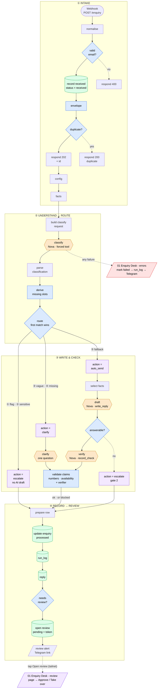

# Enquiry Desk — state

**Last updated:** 2026-10-11 · **Sessions 1–4 done, committed and pushed** (`207311d`)
**Next:** A7 credit check → README → record the Loom → use it in applications (see *Next*)

## Status

An n8n workflow that answers customer enquiries for a fictional UK tutoring company (Meridian Tutors) whose
customers are in UTC+8. It classifies each enquiry, answers only from a fact table, checks every claim before
storing a reply, routes risky cases to a person on their phone, and never loses an enquiry. Runs on **Amazon
Nova 2 Lite (Bedrock)**, paid from the AWS Free Tier credit ($99, expires 2027-03-09; **rule: credits only**).

Latest full run `20261011-030241`, 24 hand-labelled cases:

| Category | Safety flags | Missing slots | **Actions** | Invented claims in sendable replies | Failed runs | Cost / enquiry |
|---|---|---|---|---|---|---|
| 22/24 | **6/6** | 6/6 | **23/24** | **0** | 0 | ~$0.0018 |

The one action "miss" is t06 → `blocked`: the draft calculated a £190 bundle price and the validator stopped
it (label says `escalate`; both reach a human). **Nothing is emailed to customers** — approved replies get
`approved_at`; `sent_at` stays empty until a real outbound channel exists.

**What it does, in one line each**
- **Never loses an enquiry:** saved to Postgres before any model call; 202 + reference id in ~0.4 s.
- **Understands, then decides in code:** the model *extracts* (category, details, safety flags); code decides
  what's missing and where it goes. Confidence is recorded, never routed on.
- **Answers only from facts:** each category gets only its facts; a second gate asks "can the facts answer it?".
- **Checks every claim:** prices/dates/times by regex, availability by code, every other statement by a second
  model that must quote its evidence. Any unsupported claim ⇒ `blocked`.
- **People handle the risky ones:** escalated/blocked enquiries → Telegram "needs review" (no customer data) →
  tailnet review page → **Approve draft / Take over**.
- **Fails loudly:** any production failure → row `failed` (dead letter) → `run_log` → Telegram alert →
  `replay.py` re-runs it with one command. Proven by a chaos test.
- **Measured:** `score.py` re-runs the 24 cases after every change; every run is in `test/results/`.

## How it flows



Orange = model calls (the only paid, non-deterministic steps) · blue = code that decides or checks · purple =
outcomes · green = Postgres · red = errors workflow. Simplified: the exact node list is in *Node map*.

## Next

| # | Step | Why |
|---|---|---|
| 1 | **A7 credit check** — Cost Explorer, group by Service, charge type Usage + Credit (2026-10-10/11) | Confirms "credits only" holds (Bedrock usage offset by a Credit line) |
| 2 | **README.md** for the repo: problem, diagram, the numbers, how it's tested, honest limits, link to the Loom | The repo's front page is what reviewers actually read |
| 3 | **Record the Loom** in segments from the outline below (~4–5 min) | The single most persuasive artefact |
| 4 | **Clean the repo for public view:** decide on `workflows/01-intake.json` (the session-1 answer key) vs `01-intake.mine.json`; delete `test/test.json` | Avoid "which file is the real one?" |
| 5 | Optional: one **real pilot** → one-page case study (confirm Bedrock data terms before any real data) | Turns a portfolio piece into evidence for clients |

### Loom outline (record in segments; ~4–5 min)

| # | Show | Say |
|---|---|---|
| 1 | The main sticky / problem | "UK-staffed tutoring company, customers in UTC+8: the whole Asian day is unstaffed." |
| 2 | POST t01 → **202 + id** in 0.4 s → row `processed`, reply stored | "Saved first, answered only from a fact table, ~0.2¢ per enquiry." |
| 3 | t18 (child wellbeing, confidence 0.95) → **escalate**, no AI draft | "Safety flags beat confidence. A person writes this one." |
| 4 | t06 → draft computes **£190** → **blocked** by the validator | "The model invented a bundle price. Code caught it." |
| 5 | t08 (historical run) → verifier blocks "GCSE Maths on Saturdays" | "A second model checks every sentence against the facts — it caught a real mistake." |
| 6 | t24 injection → flagged `prompt_injection` → escalate | "The enquiry is data, never instructions." |
| 7 | Chaos: break the model URL → POST → **Telegram alert** → `dead_letter` → restore → `replay.py` → processed | "Failures can't vanish: marked, logged, announced, replayed with one command." |
| 8 | Escalated enquiry → Telegram "needs review" → tap **Open review** → **Approve draft** | "A person approves on their phone. No customer data in Telegram; the page is private to the tailnet." |
| 9 | `score.py` summary | "24 labelled cases: 23/24 actions, 6/6 safety flags, 0 invented claims. Re-run on every change." |
| 10 | Honest limits | "Synthetic data, 24 cases, the verifier is itself a model, and nothing is emailed yet — a real inbox is next." |

## Decisions (agent-built on request, 2026-10-10/11)

1. **Models extract, code decides.** The classifier returns `details` (subject, level, timezone, year); the
   `derive missing slots` rule table decides what's missing (`trial_booking`: subject + level; `scheduling`:
   subject). Model judgement was 2/6; extraction 24/24.
2. **Confidence is recorded, never routed on** (0.7–1.0 on everything; `intent_clear` was true on 24/24).
   "Vague" = `other` + no flags + nothing extracted.
3. **`route` Switch**, first match wins: ① any safety flag → escalate · ② `complaint_or_sensitive` → escalate ·
   ③ vague → clarify · ④ missing slots → clarify · ⑤ fallback → auto_send. Route escalations get no AI draft.
4. **Second gate:** the draft is a forced tool `write_reply` → `{reply, answerable, unanswered}`; not answerable
   ⇒ escalate (draft kept for the human). No tool call ⇒ not answerable.
5. **Clarify:** code picks what to ask; the model phrases it in the customer's language; code enforces one `?`.
6. **Claim checks:** regex for prices/%/times/dates (unverified deadlines flagged by name) + a code backstop for
   availability contradictions + a **verifier model** (`record_check`, temperature 0, quoted evidence, facts as
   plain lines). Any problem ⇒ `blocked`. Built test-first on 10 crafted replies (10/10, 9/10 on re-run).
7. **Facts need scope.** `trial.applies_to` and `booking` (how / channels / **scope**) were added after the
   drafter invented a GCSE-only trial, a website sign-up, and stretched "reply to this email" to lesson changes.
8. **Write first, enrich later.** `record received` saves the raw enquiry before any model call; a `failed` row
   can be reclaimed by a replay; anything else matching is a duplicate (200, no model calls).
9. **Failure path:** separate `01 Enquiry Desk - errors` workflow; alerts carry no customer data.
10. **Human review over the tailnet** (link buttons, not a public Funnel); POST-only actions, per-enquiry token,
    approve only when a draft exists; `approved_at` not `sent_at`.
11. **Chat ID stays out of git:** `{{ALERT_CHAT_ID}}` placeholder in exports, real value in `.env` (chosen over
    `$env`, which would expose every container secret to every workflow).

## Node map

**Intake workflow** `01 Enquiry Desk - intake` (`9OtHm7FyRtNdUl1p`, 46 nodes incl. stickies)

| Stage | Nodes |
|---|---|
| ① Intake | `Webhook` → `normalise` → `valid email?` (no → `respond 400`) → `record received` → `envelope` → `duplicate?` (yes → `respond duplicate`) → `respond 202` → `config` → `facts` |
| ② Understand → route | `build classify request` → `classify` → `parse classification` → `derive missing slots` → `route` |
| ③ auto_send | `action = auto_send` → `select facts` → `build draft request` → `draft` → `read draft` → `answerable?` → (`build verify request` → `verify` → `read verify` → `validate claims` \| `action = escalate (gate 2)`) |
| ③ clarify | `action = clarify` → `build clarify request` → `clarify` → `read clarify` → `validate claims` |
| ③ escalate | `action = escalate` |
| ④ Record → review | `prepare row` → `update enquiry` → `insert run_log` → `insert reply` → `needs review?` → `open review` → `notify a human?` → `review alert` |

**Errors** `01 Enquiry Desk - errors` (`BSmcb09mPBarqPjO`): `Error Trigger` → `read error` → `mark failed` → `build alert` → `log failure` → `telegram alert`
**Review** `01 Enquiry Desk - review` (`QQEDcUxU7OJIeNn3`): GET `review page` → `read query` → `load enquiry` → `render page` → `respond page` · POST `review action` → `read form` → `apply decision` → `render result` → `respond result`

Credentials (n8n only): `Bedrock - API key`, `Postgres account`, `Telegram - alerts bot`. Chat ID: `ALERT_CHAT_ID`
in `.env`. Settings: save successful production executions = all; intake's Error workflow = errors.
Canvas: four stacked stage frames, fits one screen at **Shift+1**.

**Repo files:** `workflows/01-intake.mine.json`, `01-errors.json`, `01-review.json` (+ `IMPORT.md`) · `kb/facts.yaml`
(source of truth — the `facts` node is a hand copy, **change both**) · `schema/` · `test/score.py`,
`test/replay.py`, `test/enquiries.jsonl`, `test/results/`.

## Results history

| Run | Category | Flags | Slots | Actions | Invented | Cost | Notes |
|---|---|---|---|---|---|---|---|
| `20261010-221447` | 21/24 | 5/5 | 2/6 | — | — | $0.00094 | **Nova baseline** |
| `20261010-233801` | 22/24 | 6/6 | 6/6 | 19/24 | — | $0.00096 | Code-derived slots, category definitions, `route` Switch |
| `20261011-001555` | 22/24 | 6/6 | 6/6 | 23/24 | 0/14 | $0.00122 | Gate 2 + clarify + numeric validator |
| `20261011-010552` | 22/24 | 6/6 | 6/6 | 22/24 | 0/13 | $0.00123 | Write-first intake |
| `20261011-014710` | 22/24 | 6/6 | 6/6 | 21/24 | 0/12 | $0.00123 | After the chaos test (t01 fact gap found) |
| `20261011-015701` | 22/24 | 6/6 | 6/6 | 22/24 | 0/13 | $0.00123 | `trial.applies_to`; 400/202/200 responses |
| `20261011-021009` | 22/24 | 6/6 | 6/6 | 22/24* | 0/12 | $0.00172 | Verifier — **caught a real error** (GCSE Maths on Saturdays). *t22 relabelled |
| `20261011-024616` | 22/24 | 6/6 | 6/6 | 22/24 | 0/12 | $0.00176 | Booking fact + scope; t20 invented content blocked (in Chinese) |
| `20261011-030241` | 22/24 | 6/6 | 6/6 | **23/24** | 0/12 | $0.00176 | **Human review live**; only miss t06 (blocked) |

All runs: `test/results/<run>.jsonl`. Run-to-run variance at temperature 0 is ±1–2/24 — compare runs, not cases.

## Open issues

- **A7 credit check** pending. Open billing question: does the credit cover Claude on Bedrock?
- **Residual risk:** the verifier is a model (~1 in 10 variance on the crafted set); only availability has a code
  backstop. Re-run the crafted set (see *Things learned*) whenever prompts change. Cost +40% from the verifier.
- **Scoring is strict on purpose:** `blocked` ≠ `escalate` (t06 counts as a miss though both reach a human).
- **t15 / t23 categories** still wrong (past-paper bank, US admissions → course_content) — replies are correct.
- **Nothing is emailed.** A real inbox (Gmail/Outlook draft) is the next product step, ideally for a pilot.
- `score.py`: no error-type counts (503 / 429 / timeout); stale `--psql` docstring example.
- Repo: `workflows/01-intake.json` is the session-1 answer key; `test/test.json` is a scratch file.

## How to run things

```bash
set -a; source .env; set +a          # loads WEBHOOK_PROD_URL, ALERT_CHAT_ID
python3 test/score.py --webhook "$WEBHOOK_PROD_URL" \
  --psql "docker exec -i n8n-stack-postgres-1 psql -U n8n -d n8n"        # all 24, ~6 min, ~4¢
python3 test/replay.py --webhook "$WEBHOOK_PROD_URL" \
  --psql "docker exec -i n8n-stack-postgres-1 psql -U n8n -d n8n" --dry-run   # list the dead letters
```
Review page: `https://raspberrypi.tailf7a7bf.ts.net/webhook/review?id=…&t=…` (tailnet only).
**Export ritual:** close every n8n tab → open fresh → unpin → export → agent scans (re-placeholders the chat ID
in intake + errors) → commit **without** an attribution trailer.

## Things learned — don't relearn them

**n8n**
- **A stale editor tab overwrites API edits** — and gets published. Happened four times. Close every tab
  before an agent edit; never Save in an old tab.
- **"Active" is "Publish"** (n8n 2.x): Save edits the draft; production runs the published version.
- **Default webhook mode answers 200 before the workflow runs.** Use Respond to Webhook nodes; answer after
  the enquiry is saved (202 + id) and keep processing afterwards.
- **Bad input ≠ failure:** return 400 instead of throwing, or every typo pages you.
- **Postgres node:** replaces the item with its result (re-attach your data) · UPDATE/INSERT with 0 rows →
  `{success: true}` and the run continues · SELECT with 0 rows → **no items**, the next node never runs
  (*Always Output Data*) · comma-list `queryReplacement` splits values with commas → `={{ [ … ] }}` ·
  `{{ }}` in SQL is string pasting → always `$1..$n`.
- **`on conflict … do update … where <cond>`** returns a row only when it updates → reclaim vs duplicate.
- **Telegram node defaults to Markdown** — `_` breaks it. Use `parse_mode: HTML` and escape `& < >`.
- **Error Trigger** fires for production runs only; nothing alerts on a failure *inside* the error workflow.
- **Tests must not page humans** — gate notifications on test traffic.
- **Public API PUT rejects `settings.binaryMode`**; several incoming branches run a node once per branch (no Merge).

**Models**
- **Let models extract, let code decide** — extraction 24/24 vs judgement 2/6. Self-reported confidence and
  vague yes/no fields are useless; a yes/no tied to a concrete check ("did you have to say *I'll check*?") works.
- **Structured JSON on Bedrock = forced tool call.** Shape is enforced, correctness isn't.
- **Every fact needs a scope** — a model applies any process you give it to everything nearby.
- **A second model as verifier** (narrow job, temperature 0, must quote evidence) + **code backstops** for
  pattern-matchable claims. **Render facts as plain lines** — small models misread nested JSON.
- **Test a model step in isolation:** throwaway webhook workflow + crafted good/bad inputs; re-run it.

**AWS / infra**
- Credit covers **"Sold by: AWS"** only (Nova yes; Claude/GPT/Grok via Marketplace, likely not).
- Cross-region inference needs the **profile ID** (`global.amazon.nova-2-lite-v1:0`).
- Two CLI profiles on the Pi: `default` = `017820696925` (not this project); Bedrock + `$5` budget = `718339078322`.
- `set -a; source .env; set +a` loads `.env`. n8n is **tailnet-only** (Tailscale Serve, no Funnel).

## Later

- **Real inbox:** Gmail/Outlook in → reply saved as a draft in their inbox; approve → actually send (`sent_at`).
- **`llm-call` sub-workflow** (provider adapter) once there's a second provider; **Ollama** on the M5 as that branch.
- **LLM-as-judge** in `score.py` for `note_expected` cases; **follow-up** workflow for unanswered clarify replies.
- **Facts in a Google Sheet** when a client must edit them; grow the test set with real (anonymised) enquiries.

## Positioning (for applications and pitches)

**Strong as proof of capability, weak as a product.** Enquiry triage is crowded; what stands out is
*reliability you can show numbers for*. Lead with the outcome ("Asian-timezone enquiries wait 7 hours; this
answers the safe majority in minutes and routes the rest to a person by morning"), then show the safety
mechanisms and the measured results. Be explicit that the client is fictional and the data synthetic.
