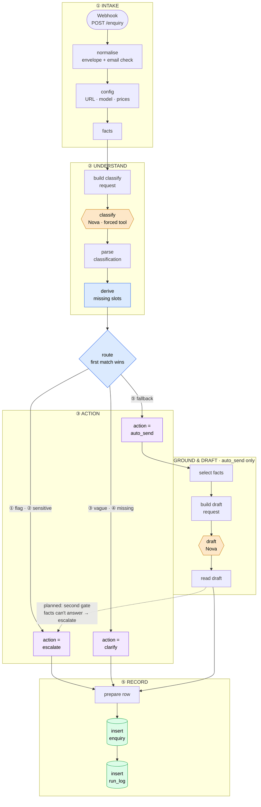

# Enquiry Desk — state

**Last updated:** 2026-10-10 · end of session (`route` Switch built by the agent: actions 19/24)
**Next:** export + commit → A7 credit check → second gate · plan below

## Status

**Session 1 (the spine) is done and runs on Amazon Nova 2 Lite (Bedrock).** A POST to the production
webhook gives one `enquiry` row and two `run_log` rows in ~3 s, at **~$0.001 per enquiry**, paid
from the AWS Free Tier credit ($99, expires 2027-03-09). **Rule: credits only** — nothing billed to the card.

**Latest run (24 cases, `20261010-230401`):** category **22/24**, safety flags **6/6**, slots **6/6**
(after the scheduling fix). Baseline was 21/24, 5/5, 2/6. Gemini version is commit `9f383b3`.

**Session 2 started: the `route` Switch is live** (run `20261010-233801`): actions **19/24**, exactly as
simulated. The 5 misses (t06, t09, t11, t12, t14) all need the *second gate* — can the facts answer
it? — which the classifier can't know.

## How it flows (as of 2026-10-10)

**Reading it:** orange = model calls (the only paid, non-deterministic steps), blue = the code that
*decides* (rule table + Switch), purple = the three outcomes, green = Postgres. Only **auto_send** gets an
AI draft. The dashed line is the next build: the draft step will report whether `<facts>` can answer the
enquiry, and escalate if not (t06, t09, t11, t12, t14).

## Next — the plan

| # | Step | Done when |
|---|---|---|
| 1 | **Reload the n8n tab, explain back** the `derive missing slots` node (see questions at the end of the session), export, scan, commit | Committed |
| 2 | **A7 credit check** (due 2026-10-11): Cost Explorer, group by Service, charge type Usage + Credit | Bedrock usage offset by a Credit line |
| 3 | **Second gate:** the draft step also says whether `<facts>` answer the enquiry (forced tool: `{reply, answerable, reason}`); if not → `action = escalate`. Targets t06, t09, t11, t12, t14 | Action accuracy → 24/24 |
| 4 | **Clarify branch:** draft ONE question from `missing_slots` (or "what can we help with?" for vague) | t02 / t21 get one-question replies |
| 5 | **Claim validator** on `draft_reply` + write the `reply` table | `score.py` scores invented prices |

## Decisions (2026-10-10, made by the agent on request)

**1. `missing_slots`: the model reports what was SAID; code decides what's MISSING.**
- The model returns `details` = `{subject, level, timezone, student_year}` as stated or clearly implied.
  It no longer returns `missing_slots`.
- New Code node **`derive missing slots`** (after `parse classification`) applies a rule table:
  `trial_booking` needs `subject` + `level`; `scheduling` needs `subject`; everything else needs nothing.
  Year 10–11 ⇒ GCSE, Year 12–13 ⇒ A-Level. It also sets `any_detail_given`.
- *Why:* "what do we need before answering?" is a business rule. A rule table is testable and
  explainable; the model's judgement was 2/6. Extraction is the thing models are good at (24/24 correct).
- *Tried and dropped:* requiring `timezone` for scheduling (broke t08/t09; the reply can just state HK time).

**2. Confidence is recorded, never routed on. Rule ③ is deterministic.**
- Nova scored 0.7–1.0 on everything. An extra `intent_clear` yes/no field was also tried: true on
  **24/24** incl. vague t21 — dropped.
- Rule ③ is now: `category = other` AND no flags AND `any_detail_given = false` → clarify.

**3. Category definitions in the schema.** One line per category. Fixed t13, t17, t19 (22/24).
Still wrong: t15 (past-paper bank → course_content, arguable) and t23 (US admissions → course_content).

**4. The `route` Switch (built 2026-10-10)** — rules in order, first match wins:
① any safety flag except `none` → **escalate** · ② `complaint_or_sensitive` → **escalate** ·
③ `other` + no details given → **clarify** · ④ `missing_slots` not empty → **clarify** ·
⑤ otherwise → **auto_send** *(provisional — the second gate can still escalate)*
- Each output → a Set node `action = …` → all rejoin at `prepare row` → `insert enquiry` (now writes `action`).
- **Only auto_send is drafted.** Escalate: a human writes it (no AI words on a safeguarding message).
  Clarify: the one-question reply comes later. Saves a model call on 7/24 enquiries.
- `read draft` (new) takes the draft text + tokens out of the response; `prepare row` now reads `$json`
  from whichever branch arrived.
- `Execute a SQL query` renamed **`insert run_log`**: array params; draft row only when `action = auto_send`.

## Done

**Session 1 build**
- [x] `schema.sql` loaded; `NODE_FUNCTION_ALLOW_BUILTIN=crypto` on the container
- [x] Session 1 nodes built and passing; retries on `classify` + `draft` (4 tries, 5 s, trap ① clear)
- [x] `test/score.py` written and working; on the Pi, `--psql` is
      `docker exec -i n8n-stack-postgres-1 psql -U n8n -d n8n`
- [x] n8n-mcp connected via `.mcp.json` (key is a `${N8N_API_KEY}` reference)
- [x] Workflow **published** (n8n 2.x's name for "active")

**2026-10-10 changes**
- [x] **Email required:** `normalise` trims, lowercases, validates, throws if missing; `from_email not null`
- [x] `contact_email` dropped from `missing_slots` (the model never sees the envelope)
- [x] **Moved to Bedrock:** $5 budget alert (credits excluded) in account `718339078322`; Nova 2 Lite via
      `global.amazon.nova-2-lite-v1:0`, region `ap-southeast-1`; n8n credential `Bedrock - API key`
- [x] **Converse rewrite** (agent, on request): `config` Set node (URL, model, $0.30 / $2.50 per MTok);
      classify uses a **forced tool call** (`record_classification`); parse/prepare read
      `output.message.content[]` and `usage.inputTokens/outputTokens`; timeouts 30 s
- [x] Schema field `description`s; `language` = BCP-47 (`t20` → `zh-HK`)
- [x] `insert enquiry` uses an **array** `queryReplacement` (comma list split JSON arrays)
- [x] **Injection fix:** `prompt_injection` flag + instruction; `t24` label expects it
- [x] Node notes and sticky notes updated from Gemini to Nova; export unpinned (53 KB → 27 KB)
- [x] `classification.schema.json` in sync with the node
- [x] **Slots + rule ③ redesigned** (see *Decisions*): `details` extraction, `derive missing slots` node,
      category definitions, `intent_clear` tried and removed. Runs `20261010-225917`, `20261010-230401`
- [x] Settings → **Save successful production executions = all** (replies and timings now reviewable)
- [x] **`route` Switch** + `action = escalate / clarify / auto_send` + `read draft`; `prepare row` serves all
      branches; `insert enquiry` writes `action`; `insert run_log` renamed + conditional draft row.
      Sticky notes updated. Validates clean. Run `20261010-233801`: actions 19/24

## Baseline

| Run | Model | Category | Safety flags | Slots | Action | Errors | Cost/enquiry | Notes |
|---|---|---|---|---|---|---|---|---|
| `20261010-221447` | nova-2-lite | **21/24** (88%) | **5/5** | 2/6 | n/a | 0 | $0.00094 | Misses: t13→trial_booking, t19→other, t23→course_content. Conf 0.8–1.0 everywhere. Before injection fix |
| `20261010-223551` (5 cases) | nova-2-lite | 5/5 | 4/4 | — | n/a | 0 | $0.00098 | After injection fix: t24 flags `prompt_injection`, no false flags on t01/t16/t18/t20 |
| `20261010-225917` | nova-2-lite | 20/24 | 6/6 | 5/6 | n/a | 0 | $0.00107 | `details` + code-derived slots. t13 slot miss caused by its category. `intent_clear` true on 24/24 |
| `20261010-230401` | nova-2-lite | **22/24** (92%) | **6/6** | **6/6**¹ | sim. 19/24 | 0 | $0.00105 | + category definitions. Misses t15, t23. ¹after the scheduling-rule fix (t07–t09 re-run) |
| `20261010-233801` | nova-2-lite | 22/24 | 6/6 | 6/6 | **19/24** | 0 | $0.00096 | **Switch live.** Misses t06, t09, t11, t12, t14 (all need the second gate). Cheaper: no draft on escalate/clarify |

## Open questions / blockers

- **t23 (US admissions) → `course_content`** every run. `select facts` hands the draft the subject list —
  check the draft doesn't invent a US-admissions service. The second gate should catch it.
- **Run-to-run variance:** category flipped on t17/t19 between runs at temperature 0. Treat ±1–2/24 as noise;
  compare runs, not single cases.
- **Drafted replies** are now in Executions (success saving on); `reply` table writes come with the validator.
- **A7:** confirm the credit really covers Nova. Billing support case open question: does it cover Claude?
- `score.py`: doesn't count errors by type (503 / 429 / timeout); docstring `--psql` example is stale.
- Scratch file `test/test.json` (modified, uncommitted) — keep out of commits or delete.

## Before every export

1. **Reload the n8n tab first** if the agent has edited the workflow (see Things learned).
2. **Unpin all nodes** — Tailscale Serve adds `tailscale-user-*` headers to the Webhook's pinned data, and
   stale pins replay old provider responses into the parsers.
3. Save as `workflows/01-intake.mine.json`, then ask the agent to scan it before `git add`.

## Things learned — don't relearn them

**n8n**
- **A stale browser tab overwrites API edits.** A tab opened before an agent edit still holds the old
  workflow; its next Save silently reverts the edit — and gets published. Happened **twice** on
  2026-10-10. **Reload after every agent edit; never Save in an old tab.**
- **n8n 2.x: "Active" is now "Publish".** Save edits the draft; production runs the published version.
  n8n-mcp edits land in both (check `workflow_history` where `versionId = activeVersionId`).
- **Successful production executions aren't saved** by default — only errors show.
- **The webhook answers 200 before the workflow runs**, so a throw still returns 200. Real 400 → session 3.
- **Postgres `queryReplacement` as a comma list splits values containing commas.** Use `={{ [ ... ] }}`.
- **A node with several incoming branches runs once per arriving branch** — no Merge node needed when
  only one branch fires per execution (Merge would wait for all inputs and hang).
- **`{{ }}` in SQL is string pasting, not parameters.** Every value goes through `$1..$n`.
- **After a Postgres node, use `$('node').first()`**, not `.item`.
- **Re-running pinned data the same day writes nothing** (`external_key` dedupe → 0 rows → no `run_log`).
- **n8n-mcp blocks private IPs by default** → `WEBHOOK_SECURITY_MODE=permissive` (dev-only Pi).
- **Tailscale Serve injects identity headers**; `normalise` drops them, execution history keeps them.

**Models**
- **Structured JSON on Bedrock = forced tool call** (`toolChoice: { tool: … }`); the result arrives
  parsed in `toolUse.input`. Shape is enforced, correctness isn't — still validate.
- **Nova adds chatty extras** ("OK\n\nHow can I assist you today?") — never rely on prompt-only JSON.
- **Models are bad at self-reported confidence** (Nova: 0.7–1.0 on everything) — and at yes/no
  self-judgements too (`intent_clear` true on 24/24). Let models **extract**; let code **decide**.
- **Gemini free tier = 20 requests/day per model**; a per-day 429 can't be retried away. Gemini 3.8 Flash
  thinking (~730 tokens) made calls slow enough to hit 30 s timeouts.

**AWS**
- **Credit applies to "Sold by: AWS" only.** Claude, Grok, GPT on Bedrock are sold by the vendor via AWS
  Marketplace. The "Serverless" vs "Bedrock Marketplace" tabs are about hosting, not billing.
- **Cross-region inference needs the profile ID** (`us.` / `apac.` / `global.` prefix), not the bare ID.
  Global profiles need `arn:aws:bedrock:::foundation-model/…` in IAM policies too.
- **New accounts start "being verified"** — Bedrock returns 403 for up to ~2 h.
- **The Pi has two AWS CLI profiles.** `default` = account `017820696925` (not mine for this project);
  Bedrock + budget are `718339078322`. Check `aws sts get-caller-identity` or pass `--profile`.

**Shell**
- **`.env` isn't loaded automatically:** `set -a; source .env; set +a` (auto-exports while sourcing).
- **`docker exec -i … psql` with nothing piped in just waits** (no tty). Use `-it` by hand.

## Later (not now)

- **Session 2, rest:** clarify branch (one question), claim validator on `draft_reply` + write the
  `reply` table (lets `score.py` check invented prices), review queue, follow-up.
- **Session 3:** `llm-call` sub-workflow as a **provider adapter** — same input `{ provider, system,
  user, schema?, max_tokens }`, a Switch with one HTTP node + credential per provider (Bedrock, Ollama,
  Gemini), same output `{ text, json, tokens_in, tokens_out, model, cost_usd }`; 429-aware retries
  (retry 503/timeout, stop on per-day 429); dead-letter + Telegram alert; real 400 via Respond to
  Webhook; Loom.
- **Local LLM backend:** Ollama on the M5 MacBook (16 GB, ~8B model, `format` = schema, `think: false`)
  over Tailscale, as an `llm-call` branch. Score local vs Nova on the same 24 cases. RTX 4060 box if it
  must be always on.
- **Optional:** LLM-as-judge in `score.py` for `note_expected` cases (t03, t19, t22, t23).

## Session 4 — make it sellable (before pitching)

Verdict (2026-10-10): **strong as proof of capability, weak as a product.** Enquiry triage is crowded
(templates, Zapier AI, Intercom Fin); nobody buys the workflow file. What sells is *reliability you can
show numbers for*, in the buyer's own tools, proven on one real business.

1. **Every number presentable** — slots, action accuracy and the validator fixed in sessions 2–3, so
   the Loom shows t05's invented discount being **blocked** and t18 escalating at high confidence.
2. **Real channel:** Gmail/Outlook in → reply saved as a **draft in their inbox** → Telegram/Slack
   **approve / edit / escalate** buttons. Staged rollout: approve-all → auto-send the safe categories.
3. **Outcome-first pitch:** "Asian-timezone enquiries wait 7 hours; this answers the safe majority in
   minutes and hands the rest to a human by morning." The workflow is the evidence, not the pitch.
4. **One real pilot** (tutor, clinic or agency with cross-timezone enquiries), even unpaid → one-page case
   study with before/after response times. Synthetic data rule still applies until off the free tier
   models (Nova/Bedrock doesn't train on inputs — confirm before real data).
5. **Sell as a service:** setup fee + monthly retainer (monitoring, fact-table updates, `score.py` as a
   gate on every prompt change). Facts in a Google Sheet the client can edit.
6. **Be honest about scale:** "24 hand-labelled cases incl. the 4 hardest failure modes" — grow the set
   with real (anonymised) pilot enquiries.
