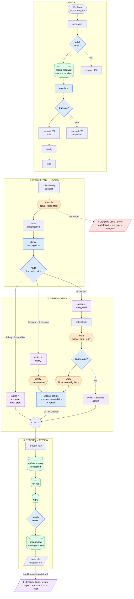

# Enquiry Desk — state

**Last updated:** 2026-10-17. This file is the **technical record**: results, decisions and their reasons, node map,
lessons learned, how to run things. Current status and next steps live in the project notes (loaded at session start).

## Status

An n8n workflow that answers customer enquiries for a fictional UK tutoring company (Meridian Tutors) whose
customers are in UTC+8. It classifies each enquiry, answers only from a fact table, checks every claim before
storing a reply, routes risky cases to a person on their phone, and never loses an enquiry. Runs on **Amazon
Nova 2 Lite (Bedrock)**, paid from the AWS Free Tier credit ($99, expires 2027-03-09; **rule: credits only**).

Latest full run on the **live** workflow, `20261017-113732` (and two staging runs that match it), 24 hand-labelled cases:

| Category | Safety flags | Missing slots | **Actions** | Invented claims in sendable replies | Failed runs | Cost / enquiry |
|---|---|---|---|---|---|---|
| 22/24 | **6/6** | 6/6 | **21/24** (both runs) | **0** | 0 | **~$0.0023** (corrected prices) |

**Cost note:** runs before 2026-10-17 used the wrong per-token price and under-stated cost by ~36% (they show ~$0.0018
for what is really ~$0.0025). Compare cost only between runs made after the correction. The earlier live run
`20261011-030241` scored 22/24 · 6/6 · 23/24; 23/24 vs 21/24 sits at the edge of the usual ±1–2/24 spread (the prompts did not
change, only the layout and the per-stage config).

The one action "miss" is t06 → `blocked`: the draft calculated a £190 bundle price and the validator stopped
it (label says `escalate`; both reach a human). **Nothing is emailed to customers** — approved replies get
`approved_at`; `sent_at` stays empty until a real outbound channel exists.

**What it does, in one line each**
- **Never loses an enquiry:** saved to Postgres before any model call; 202 + reference id in ~0.4 s.
- **Understands, then decides in code:** the model *extracts* (category, details, safety flags); code decides
  what's missing and where it goes. Confidence is recorded, never routed on.
- **Answers only from facts:** each category gets only its facts; a second gate asks "can the facts answer it?".
- **Checks every claim:** prices/dates/times by regex, availability by code, every other statement by a second
  model that must quote its evidence. Any unsupported claim ⇒ `blocked`.
- **People handle the risky ones:** escalated/blocked enquiries → Telegram "needs review" (no customer data) →
  tailnet review page → **Approve draft / Take over**.
- **Fails loudly:** any production failure → row `failed` (dead letter) → `run_log` → Telegram alert →
  `replay.py` re-runs it with one command. Proven by a chaos test.
- **Measured:** `score.py` re-runs the 24 cases after every change; every run is in `test/results/`.

## Staging, run comparison and the gate (2026-10-17)

Goal: let creation and testing run unattended. Feasibility was checked first (headless `claude -p` on a Pi cron
works; cloud routines can't reach the tailnet-only n8n). What exists:

- **Staging copy of intake + errors** (`test/staging.py create | sync | status`; ids in `test/staging.json`):
  webhook `/webhook/enquiry-staging`, errors copy has no Telegram, the intake `review alert` node is disabled.
  Why: `score.py` tests the *published* version through a production-mode webhook, so an unattended builder that
  edits the live workflow could only test by publishing it. It works on staging; **a person promotes to live.**
  `sync` re-copies live → staging after a promotion. Staging has its **own database** `enquiry_staging` (decision 20); scoring traffic is `test+…@example.com`, the generated column `enquiry.is_test` (decision 19).
- **`score.py --label`** names a run (model set / prompt) in the results file.
- **`test/compare.py`** prints a table of runs, and `--check RUN` gates a run against `test/baseline.json`:
  safety flags all pass · 0 invented claims · 0 failed · category and actions within **±1** of baseline · cost
  within **+25%**. Gate proven both ways (passes a normal run, fails a doctored one). Tolerance and margin are
  flags; I chose the defaults, change them if they feel wrong.
- **Baseline** = `20261017-082124` (staging, Nova 2 Lite on all four calls, per-stage config, corrected prices):
  category 22/24, flags 6/6, slots 6/6, actions 21/24, 0 invented, $0.002401. Run #2 (`20261017-082529`) matched it
  with cost $0.002191, so cost varies ~±5% between runs. It replaced the first baseline (`20261017-075031`, old prices).
- **Promotion** is `python3 test/staging.py promote` (read-only plan: shows each stage's model on live and on staging) then
  `promote --yes`, run **by a person**. It **refuses** while a sweep runs, and when staging holds a non-default model unless
  `--allow-models`. It
  backs up live to `~/.local/state/enquiry-desk/`, applies staging's graph with live's webhook path/ids/Telegram state,
  publishes, and checks settings survived; `rollback --yes` undoes it. The agent's permission layer blocks production
  deploys, so an agent can plan a promotion but not apply it.
- **Trying a model:** `staging.py models` shows each stage's model and `set-model stage=model` changes one (only models priced
  in `config.model_prices`). For anything beyond a single run use **`test/sweep.py`**: `start --exp draft=pro --exp
  draft=pro,verify=pro --runs 2` (add `--dry-run` first), then `status`, `report`, and `stop` to end it. It takes a lock (so
  `set-model` and `sync` refuse while it runs), restores staging to Nova 2 Lite on every exit path, gates each full run against the
  baseline (cost margin +500% by default: accuracy first), and never touches the live workflow. Tested: dry run, double start
  refused, manual changes refused, `stop` mid-run restores in ~2 s and leaves no results file, a run to completion reports.
- **Move fallout fixed:** the repo moved to `~/deeowemez/repos/enquiry-desk`; memory folder and the four disabled
  connectors copied to the new project key, and the no-trailer rule is now **rule 7 in `CLAUDE.md`**.

## How it flows



Orange = model calls (the only paid, non-deterministic steps) · blue = code that decides or checks · purple =
outcomes · green = Postgres · red = errors workflow. Simplified: the exact node list is in *Node map*.

## Loom outline

Record in segments, about 4–5 minutes.

| # | Show | Say |
|---|---|---|
| 1 | The main sticky / problem | "UK-staffed tutoring company, customers in UTC+8: the whole Asian day is unstaffed." |
| 2 | POST t01 → **202 + id** in 0.4 s → row `processed`, reply stored | "Saved first, answered only from a fact table, ~0.2¢ per enquiry." |
| 3 | t18 (child wellbeing, confidence 0.95) → **escalate**, no AI draft | "Safety flags beat confidence. A person writes this one." |
| 4 | t06 → draft computes **£190** → **blocked** by the validator | "The model invented a bundle price. Code caught it." |
| 5 | t08 (historical run) → verifier blocks "GCSE Maths on Saturdays" | "A second model checks every sentence against the facts — it caught a real mistake." |
| 6 | t24 injection → flagged `prompt_injection` → escalate | "The enquiry is data, never instructions." |
| 7 | Chaos: break the model URL → POST → **Telegram alert** → `dead_letter` → restore → `replay.py` → processed | "Failures can't vanish: marked, logged, announced, replayed with one command." |
| 8 | Escalated enquiry → Telegram "needs review" → tap **Open review** → **Approve draft** | "A person approves on their phone. No customer data in Telegram; the page is private to the tailnet." |
| 9 | `score.py` summary | "24 labelled cases: 23/24 actions, 6/6 safety flags, 0 invented claims. Re-run on every change." |
| 10 | Honest limits | "Synthetic data, 24 cases, the verifier is itself a model, and nothing is emailed yet — a real inbox is next." |

## Decisions (agent-built on request, 2026-10-10/11)

1. **Models extract, code decides.** The classifier returns `details` (subject, level, timezone, year); the
   `derive missing slots` rule table decides what's missing (`trial_booking`: subject + level; `scheduling`:
   subject). Model judgement was 2/6; extraction 24/24.
2. **Confidence is recorded, never routed on** (0.7–1.0 on everything; `intent_clear` was true on 24/24).
   "Vague" = `other` + no flags + nothing extracted.
3. **`route` Switch**, first match wins: ① any safety flag → escalate · ② `complaint_or_sensitive` → escalate ·
   ③ vague → clarify · ④ missing slots → clarify · ⑤ fallback → auto_send. Route escalations get no AI draft.
4. **Second gate:** the draft is a forced tool `write_reply` → `{reply, answerable, unanswered}`; not answerable
   ⇒ escalate (draft kept for the human). No tool call ⇒ not answerable.
5. **Clarify:** code picks what to ask; the model phrases it in the customer's language; code enforces one `?`.
6. **Claim checks:** regex for prices/%/times/dates (unverified deadlines flagged by name) + a code backstop for
   availability contradictions + a **verifier model** (`record_check`, temperature 0, quoted evidence, facts as
   plain lines). Any problem ⇒ `blocked`. Built test-first on 10 crafted replies (10/10, 9/10 on re-run).
7. **Facts need scope.** `trial.applies_to` and `booking` (how / channels / **scope**) were added after the
   drafter invented a GCSE-only trial, a website sign-up, and stretched "reply to this email" to lesson changes.
8. **Write first, enrich later.** `record received` saves the raw enquiry before any model call; a `failed` row
   can be reclaimed by a replay; anything else matching is a duplicate (200, no model calls).
9. **Failure path:** separate `01 Enquiry Desk - errors` workflow; alerts carry no customer data.
10. **Human review over the tailnet** (link buttons, not a public Funnel); POST-only actions, per-enquiry token,
    approve only when a draft exists; `approved_at` not `sent_at`.
11. **Chat ID stays out of git:** `{{ALERT_CHAT_ID}}` placeholder in exports, real value in `.env` (chosen over
    `$env`, which would expose every container secret to every workflow).
12. **Canvas: fan-out + join** (2026-10-12). Branches fan out from `route` to an action column and rejoin at
    `to record` (No Operation), so only 2 lines run back to the left (`facts` → ②, `to record` → ④). Chosen over a
    left-to-right staircase (~2× wider) and over Tidy Up (always left to right; tidy one row at a time).
13. **Dashboard numbers live in Postgres views** (2026-10-14), not in the chart tool: one definition for
    Grafana / React / README, versioned in `schema/`, and a dashboard user can be granted the views only (no
    customer data). Blocked runs log `validate`/`failed` in `run_log` — that's a block, not a system failure;
    `stats_health` excludes it.
14. **Nova only; compare models per stage** (2026-10-14): Anthropic on Bedrock isn't covered by the credit.
    See *Model strategy*.
15. **HTTP Request nodes, not n8n's AI nodes** (checked 2026-10-16/17). It began as the session-1 pattern, not a
    recorded choice; here is why it holds. The alternative is Basic LLM Chain + AWS Bedrock Chat Model +
    Structured Output Parser (not the AI Agent node: code decides, not the model).

    | Need | HTTP Request (now) | Basic LLM Chain + Bedrock Chat Model |
    |---|---|---|
    | Forced tool call (`toolChoice`) → guaranteed JSON shape | Yes | No setting for it (options: temperature, max tokens, top P, retries, timeout, guardrail, free-form extra fields). The parser prompts for JSON — *not verified in this version* |
    | Token counts → cost per enquiry in `run_log` | From the response `usage` | Output is text; no token counts found *(unverified)* |
    | Credentials | Bedrock API key (header auth) | AWS IAM keys or assumed role — the current key won't work |
    | Inference profile ID | Typed into the URL | Dropdown (listed, untested) |
    | Per-stage model comparison | Needs the `config` split | Natural (one model node per chain) |
    | Fewer nodes / less parsing | No (4 build + 4 read Code nodes) | Yes |

    **Kept HTTP:** every measured number (6/6 flags, 0 invented claims, ~$0.0018) is from this version, and a swap
    means re-measuring. `clarify` (plain text, no tool) is the only clean swap and isn't worth making one of four
    inconsistent. Optional experiment: build `clarify` as a chain in a scratch copy and compare. Answer for "why not
    the AI nodes?": forced tool calls for guaranteed structure, token usage for per-stage cost.
16. **An automated builder works on a staging copy; a person promotes to live** (2026-10-17). `score.py` tests the
    published version, so testing a change on the live workflow means publishing it. Staging (`test/staging.py`)
    removes that: same graph, own webhook path, no Telegram. A change qualifies only if `compare.py --check` passes
    (safety 6/6, 0 invented, 0 failed, accuracy ±1, cost +25%) on two runs. Promotion stays manual.
17. **Outbound = a Gmail DRAFT on approve, never an auto-send** (2026-10-17). Approving a reply on the review page creates a draft
    addressed to the customer in the business Gmail inbox; a person reads it there and presses Send. `reply.drafted_at`,
    `gmail_draft_id` and `draft_error` record the result; `sent_at` stays empty (nothing here ever sends). If Gmail fails the approval
    still stands and the reviewer sees why. Built on a **staging copy of the review workflow** (`create-review`; `promote review` to
    go live). Needs a Gmail OAuth2 credential in n8n; use a **dedicated mailbox**, not a personal one (the credential's scopes are broad).
    Tested on staging without the credential: the failure path (page says "Approved, but the Gmail draft could not be created" and
    why; database records `draft_error`), plus repeat approve → "Nothing changed", take over, and a bad token → rejected.
    **Live since 2026-10-17** (credential `Gmail - drafts`, promoted with `promote review --yes`): the success path was verified on staging and
    live: approving a synthetic enquiry created a draft, set `gmail_draft_id` and `drafted_at`, left `sent_at` empty.

18. **Cleared (`auto_send`) and `clarify` replies also get a Gmail DRAFT** (2026-10-18, **live**). Until now these
    stopped at `record` with no draft, no review and no send, so nothing delivered them. The staging intake now has a branch off the
    unused "no review needed" output of `needs review?`: `draft for cleared?` (action `auto_send` or `clarify`, has text, not blocked,
    and **not `test+…` scoring traffic**, so test runs do not fill the mailbox) → `create gmail draft` → `record draft` (same node and
    columns as decision 17; a Gmail failure only sets `draft_error`). `sent_at` stays empty: a person still presses Send. Tested on
    staging: cleared and clarify enquiries from a non-test address got drafts; a `test+` one and an escalation did not (escalations go through
    review as before). A full staging run passes the gate: 22/24, flags 6/6, actions 23/24, 0 invented, $0.002327, no drafts from scoring.
    **Promoted 2026-10-18** (backup `promote-20261018-060831.json`; the plan also carried cosmetic sticky-note size/position edits and a `version` field on `route`'s conditions, which I checked left the routing identical). **Verified live**: a cleared and a clarify enquiry from non-test addresses got drafts, a `test+` one did not, `sent_at` empty; promote plan now empty. `WORKFLOW.md`, `IMPORT.md` and the README updated.
    Open: nothing tells staff a new draft exists (no Telegram message for them); they find it in Gmail Drafts.

19. **Scoring traffic (`is_test`) is defined once, in the database** (2026-10-18, **live**).
    It used to be the string `test+` written in four places (two intake nodes, the `stats_enquiry` view, `score.py`), so a change in one
    would silently break the others, and a real sender whose address began `test+` would get no alert and no draft. Now `enquiry.is_test` is a
    **generated column**: `from_email ~* '^test\+[^@]*@example\.com$'` (it also requires `@example.com`, a domain that cannot receive mail, so a
    customer can't trigger it). `record received` returns it (`returning id, is_test`), `envelope` and `prepare row` carry it, and
    `notify a human?` and `draft for cleared?` read `is_test` instead of `startsWith('test+')`. `stats_enquiry` reads the column (counts
    unchanged: 14 real, 755 test). The column does not touch the live workflow (it neither writes nor reads it), so the schema change was safe
    ahead of the promotion. Tested on staging: `test+…@example.com` flagged and no draft; `parent+…` drafted; `test+…@gmail.com` **not** treated as
    test (drafted); a duplicate still refused (200). Full staging run `20261018-142648` passes every gate, 0 drafts from 40 scoring replies.
    **Promoted 2026-10-18** (5 nodes: `record received`, `envelope`, `prepare row`, `notify a human?`, `draft for cleared?`; backup `promote-20261018-071303.json`).
    Verified live: `test+…@example.com` flagged and no draft, `parent+…` drafted, `test+…@gmail.com` not a test (drafted), duplicate refused, `sent_at` empty,
    live Postgres nodes still on the live credential, nothing in `enquiry_staging`. `WORKFLOW.md` updated. Existing databases need the `alter table` in `schema/schema.sql`.

20. **Staging has its own database** (2026-10-18, **live**; no production workflow change). Staging used to write to the same tables as production,
    so staging runs polluted the real stats (the "14 real" enquiries were mostly staging tests), staging reviews sat in the live queue, a schema
    change hit production before it was promoted, and the shared duplicate key could collide across environments. Now `enquiry_staging` (same Postgres
    server, `schema/schema.sql` applied; columns, views and indexes verified identical to production) holds staging data, and the staging workflows use a
    second n8n credential, `Postgres - staging` (id in `test/staging.json`, no secret stored). `staging.py` swaps the credential when it builds staging
    (`create`, `sync`), has `use-db` to switch the existing staging workflows in place, and `promote` **puts production's credential back** on every node
    (including nodes new in staging) and refuses if the promoted graph would still use the staging one; checked: 0 of 9 promoted Postgres nodes use it, and
    the promote plan is unchanged (the 5 `is_test` nodes). `sweep.py` defaults to the staging database. Verified: a staging post and an escalation landed in
    `enquiry_staging` and not in production; the staging review page read the staging row and the same link is "Not found" on the live page; full staging run
    `20261018-150335` passes every gate with all 24 enquiries in `enquiry_staging`. **Pass `--psql ... -d enquiry_staging` to `score.py` and `replay.py` for
    staging.** Every schema change must now be applied to both databases, staging first. Not exercised: the staging errors workflow (a real staging failure).

21. **Staff console, phase 1 (read-only)** (2026-10-18, **running** at `https://raspberrypi.tailf7a7bf.ts.net:8444`, not committed yet). TypeScript end to end:
    a Fastify API (`console/server/`) plus a React/Vite app (`console/web/`), one Docker container (30 MB), joined to the `n8n-stack_default` network,
    published on `127.0.0.1:3100` and reached through Tailscale Serve, which supplies the signed-in user (`Tailscale-User-Login`). It needs a backend because
    the browser must not hold a database login and the privacy rules (no customer text, no token in lists) have to be enforced on a server. Data comes only from
    views: `schema/console_views.sql` adds `stats_block_problem` (the single bucketing of block reasons; `stats_block_reasons` now counts it),
    `stats_run_stage` (run_log with `error` bucketed, never raw) and `stats_enquiry_detail` (structured fields plus `review_token`, console only), read through
    the new `console_ro` role (`schema/console_role.sql`; SELECT on the views only, read-only by default; verified denied on `enquiry` and `reply`). Applied to
    **both** databases. Screens: Overview, Needs a person, Enquiries + detail drawer, Blocked & why + popup, Cost & models, Health; Facts and Prompts are greyed
    "soon". Reasons are built from fixed vocabularies in `console/shared/labels.ts`. 24 integration tests (`npm test`) cover sign-in, input validation including a
    hostile value, no forbidden fields or tokens in any list response, the review link appearing only as `reviewUrl` on a detail, security headers, that real + test
    traffic is exhaustive, and that the login can't read raw tables. Phase 2: facts editing (needs the facts in the database, not the hand-copied node), a read-only
    Prompts tab, and re-checks on staging (see the console mockups). Grafana was removed the same day (see *Dashboard*).

22. **Facts in the database, and staff console phase 2** (2026-10-18, **live**).
    The fact table moved from a hand-copied JavaScript object into `fact_set` (`schema/facts.sql`, both databases): one row per version,
    statuses `draft` / `live` / `archived` / `discarded`, at most one `live` and one `draft` (partial unique indexes), seeded as v1 from the old node
    (byte-identical, key order included). In each database the workflow reads its single `live` row, so **staging's live set is the candidate under test and
    production's is what customers' replies are grounded on**; publishing copies a tested document across. Staging workflow: a new `load facts` Postgres node
    (credential `Postgres - staging`; Always Output Data on) feeds the `facts` Code node, which now takes the document from it and passes the original items
    through, so every node reading `$('facts').first().json.facts` is unchanged; `prepare row` and `update enquiry` record `enquiry.facts_version`. A missing
    live set throws "No live fact set" and the staging errors workflow marks the row `failed` (tested; this also finally exercised the staging errors workflow).
    `score.py` takes its "allowed numbers" from the database under test (falling back to the seed `kb/facts.json`), so an edited price isn't flagged as invented.
    **Lessons:** (1) **store the document as `json`, not `jsonb`**: jsonb re-sorts object keys, which put `trial` before the price in what the model sees and
    made a plain price question block twice; json keeps the author's order exactly. (2) **A Postgres node that returns 0 rows emits no items**, so the node after it
    never runs and the execution ends "successfully" with the enquiry stuck at `received`: `load facts` needs Always Output Data so the next node throws.
    (3) `parse classification` rebuilds the item from `envelope`, so values set after it (like `facts_version`) are read back with `$('facts')`, as the facts are.
    (4) The console's gate **runs the existing `score.py` and `compare.py`** (the image carries python3, psql, the scorer and the baseline run's results) instead of
    re-implementing them, so it can't disagree with the command line; a comparison that can't run (missing baseline file) is reported as an error and records
    nothing, never as a failed gate.
    **Console (`console/`, port 8444):** Facts (list with the topics that see each fact, edit into a draft, diff, apply to staging, run the 24-case test, publish,
    history and restore), a read-only Prompts tab (a snapshot generated from the workflow export, with a test that fails when it is stale), and re-checks (one
    enquiry, or the latest N of a topic, re-sent to staging as `test+recheck-…` so no Gmail draft, no Telegram, not real traffic; the text is read with a narrow login
    and never returned). **Publishing is refused unless exactly the staged facts passed the gate** (`publishGuard`, unit-tested), nothing is ever deleted (the
    `console_facts` login has no DELETE; a thrown-away draft is marked), edits are validated against the shape the workflow relies on (zod, tested against the real
    table, with a prototype-pollution-safe path parser), and the topic mapping mirrors `select facts` (a test parses the workflow and fails on drift; it also showed that
    `policies` is shown to no topic today). 80 tests. Acceptance: draft → apply → 24-case gate → publish → restore against a throwaway production database; the gate
    run from inside the container passes (`20261018-083234`: 22/24, 6/6, 22/24, 0 invented, $0.00238).
    **Promoted 2026-10-18** (4 nodes; backup `promote-20261018-084242.json`): live Postgres nodes all on production's credential, two live enquiries
    answered with `facts_version` 1, nothing in staging, the console now reports the workflow reads the table, and a full live run `20261018-164314` passes every
    gate (22/24, 6/6, 23/24, 0 invented, $0.00238). `kb/facts.json` (exported from production v1, identical to the old node, order included) is now the seed for
    `seed-facts.mjs`, the unit tests and `score.py`'s fallback; `kb/facts.yaml` is kept only for its comments. WORKFLOW, IMPORT, README and CLAUDE.md updated.

## Model strategy (decided 2026-10-14)

- **Nova models only** while the credit is the budget (rule: credits only). Claude is out until a client pays.
- **Develop and test on the cheapest model that works; step up to compare, then pick the best.** Cheap runs make
  iteration nearly free (~4¢ per full 24-case run).
- **Compare per stage, not just per run.** The four calls need different things: `classify` extracts (cheap model
  likely fine), `draft` writes grounded prose, `verify` judges claims (the call most likely to need a stronger
  model), `clarify` is one short question. Try a different model on each and keep the cheapest set that holds
  the safety numbers.
- **Decision rule:** a model set qualifies only if **safety flags stay 6/6, invented claims stay 0 and actions
  don't drop**; among those, lowest cost per enquiry wins. Judge on ≥2 runs — run-to-run variance is ±1–2/24.

**Per-stage config (built 2026-10-17; promoted to live the same day and verified by a full live run).** The `config` node now holds `bedrock_base`,
one model per stage (`classify_model`, `draft_model`, `verify_model`, `clarify_model`) and `model_prices`, a JSON table of
$ per million tokens keyed by model id. To try a model on one stage, edit that stage's `*_model` and nothing else. The
four HTTP nodes build their URL from their stage's model; each `read …`/`parse …` node prices its call from the table
and **throws if the model has no entry** (a missing price must fail loudly, never log $0). `run_log.model` now records
each stage's own model: **before this it recorded the classify model on every row** (an earlier version of this file
claimed otherwise; it was wrong). `score.py --label` and `compare.py` are built. Export: `test/staging.py export` →
`workflows/01-intake.staging.json`. **Check before trusting a small model:** every call relies on a *forced tool call*
(`toolChoice`), and Micro may not support it or may do it less reliably than Lite.

**Findings: `classify` (2026-10-17; one stage changed, the rest on Nova 2 Lite; baseline 22/24 category, 21/24 actions, $0.0024)**

| `classify` model | Category | Flags | Slots | Actions | Cost / enquiry | Gate |
|---|---|---|---|---|---|---|
| Nova 2 Lite (baseline) | 22/24 | 6/6 | 6/6 | 21/24 | $0.0024 | n/a |
| Nova Micro | 17/24 (both runs) | 6/6 | 5/6 | 13/24 | $0.00066 | **fails** |
| Nova Lite | 19/24 (both runs) | 6/6 | 5/6 | 21/24 | $0.00134 | **fails** (category) |
| Nova Pro | 20/24 (both runs) | 6/6 | 5/6 | 19–20/24 | $0.00246 | **fails** |

No cheaper model qualifies for `classify`; safety flags held at 6/6 throughout. Micro falls back to `other` on five cases (t05, t07,
t09, t10, t11), Lite misreads t14, t19 (complaint → other; the safety flag still caught it) and t21, and **Nova Pro scores below
Nova 2 Lite while costing more** ($1.08 / $4.32 per million tokens vs $0.41 / $3.39), so it is dropped from the comparison. Results
were identical across the two runs of each model (temperature 0). **Caveat:** the classifier prompt and category definitions were
tuned on Nova 2 Lite, so this measures "drop-in replacement", not each model's best. Cost for the non-Nova-2-Lite rows uses the AWS
list price and is **not yet checked against billing** (Cost Explorer lags ~1 day).

**Titan:** AWS confirms first-party models (Nova, Titan) are standard usage covered by the credit. But on this
account Titan is **embeddings only** (checked 2026-10-14 in ap-southeast-1, us-east-1, us-west-2: no Titan *text*
model is offered; the text models are retired). So it can't be one of the four calls. It would fit a future
"find similar past enquiries" / thread-matching feature (`amazon.titan-embed-text-v2:0`, us-east-1/us-west-2 only).

**Candidates and prices** (AWS Price List API, on-demand, `ap-southeast-1`, 2026-10-17; $ per million tokens):

| Model | Profile id | Input | Output |
|---|---|---|---|
| Nova Micro | `apac.amazon.nova-micro-v1:0` | 0.047 | 0.188 |
| Nova Lite | `apac.amazon.nova-lite-v1:0` | 0.081 | 0.324 |
| **Nova 2 Lite (current)** | `global.amazon.nova-2-lite-v1:0` | **0.41** | **3.39** |
| Nova Pro | `apac.amazon.nova-pro-v1:0` | 1.08 | 4.32 |

Nova 2 Lite costs about 5× Nova Lite on input and 10× on output, so a cheaper model on `classify` / `clarify` could cut
cost a lot. The `apac.` rows are the in-region price; confirm on first use that AWS bills the same (see *Things learned*).

## Node map

**Intake workflow** `01 Enquiry Desk - intake` (`9OtHm7FyRtNdUl1p`, 51 nodes incl. stickies)

| Stage | Nodes |
|---|---|
| ① Intake | `Webhook` → `normalise` → `valid email?` (no → `respond 400`) → `record received` → `envelope` → `duplicate?` (yes → `respond duplicate`) → `respond 202` → `config` → `load facts` → `facts` |
| ② Understand → route | `build classify request` → `classify` → `parse classification` → `derive missing slots` → `route` |
| ③ auto_send | `action = auto_send` → `select facts` → `build draft request` → `draft` → `read draft` → `answerable?` → (`build verify request` → `verify` → `read verify` → `validate claims` \| `action = escalate (gate 2)`) |
| ③ clarify | `action = clarify` → `build clarify request` → `clarify` → `read clarify` → `validate claims` |
| ③ escalate | `action = escalate` |
| ③ join | `validate claims`, `action = escalate (gate 2)`, `action = escalate` → `to record` (No Operation) |
| ④ Record → review | `prepare row` → `update enquiry` → `insert run_log` → `insert reply` → `needs review?` → (`open review` → `notify a human?` → `review alert` \| `draft for cleared?` → `create gmail draft` → `record draft`) |

**Errors** `01 Enquiry Desk - errors` (`BSmcb09mPBarqPjO`): `Error Trigger` → `read error` → `mark failed` → `build alert` → `log failure` → `telegram alert`
**Review** `01 Enquiry Desk - review` (`QQEDcUxU7OJIeNn3`): GET `review page` → `read query` → `load enquiry` → `render page` → `respond page` · POST `review action` → `read form` → `apply decision` → `render result` → `respond result`

Credentials (n8n only): `Bedrock - API key`, `Postgres account`, `Telegram - alerts bot`. Chat ID: `ALERT_CHAT_ID`
in `.env`. Settings: save successful production executions = all; intake's Error workflow = errors.
Canvas: four stacked stage frames (3620 px wide), fits one screen at **Shift+1**.

**Repo files:** `WORKFLOW.md` (node-by-node guide) · `workflows/01-intake.mine.json`, `01-errors.json`,
`01-review.json` (+ `IMPORT.md`) · `kb/facts.json` (seed of the `fact_set` table, which is the live fact table; change facts in the console) · `schema/schema.sql` (tables, `dead_letter`, `stats_*` views) · `test/score.py`, `test/replay.py`,
`test/staging.py` (+ `staging.json`), `test/compare.py` (+ `baseline.json`), `test/enquiries.jsonl`, `test/results/`.

**Dashboard views** (all read-only, no email/subject/body):

| View | Gives |
|---|---|
| `stats_enquiry` | One row per enquiry: day (HKT), status, category, action, flags?, review status, `is_test`, `cost_usd`, `model_calls` |
| `stats_daily` | Enquiries per day × status × action |
| `stats_cost` | Per day: processed count, total spend, average cost per processed enquiry |
| `stats_pending_reviews` | Pending reviews, oldest first, with `waiting` |
| `stats_block_reasons` | Why replies were blocked, bucketed (gate 2, invented price, verifier, …) |
| `stats_health` | One row: dead letter, stuck, pending reviews, failures in 24 h, last processed |

Snapshot 2026-10-14: 58 blocked replies = 45 gate 2 · 10 invented price · 3 verifier; 11 pending reviews; 2 stuck.

## Results history

| Run | Category | Flags | Slots | Actions | Invented | Cost | Notes |
|---|---|---|---|---|---|---|---|
| `20261010-221447` | 21/24 | 5/5 | 2/6 | — | — | $0.00094 | **Nova baseline** |
| `20261010-233801` | 22/24 | 6/6 | 6/6 | 19/24 | — | $0.00096 | Code-derived slots, category definitions, `route` Switch |
| `20261011-001555` | 22/24 | 6/6 | 6/6 | 23/24 | 0/14 | $0.00122 | Gate 2 + clarify + numeric validator |
| `20261011-010552` | 22/24 | 6/6 | 6/6 | 22/24 | 0/13 | $0.00123 | Write-first intake |
| `20261011-014710` | 22/24 | 6/6 | 6/6 | 21/24 | 0/12 | $0.00123 | After the chaos test (t01 fact gap found) |
| `20261011-015701` | 22/24 | 6/6 | 6/6 | 22/24 | 0/13 | $0.00123 | `trial.applies_to`; 400/202/200 responses |
| `20261011-021009` | 22/24 | 6/6 | 6/6 | 22/24* | 0/12 | $0.00172 | Verifier — **caught a real error** (GCSE Maths on Saturdays). *t22 relabelled |
| `20261011-024616` | 22/24 | 6/6 | 6/6 | 22/24 | 0/12 | $0.00176 | Booking fact + scope; t20 invented content blocked (in Chinese) |
| `20261011-030241` | 22/24 | 6/6 | 6/6 | **23/24** | 0/12 | $0.00176 | **Human review live**; only miss t06 (blocked) |
| `20261017-075031` | 22/24 | 6/6 | 6/6 | 22/24 | 0/11 | $0.00165 | **Staging baseline** (Nova 2 Lite ×4, re-laid-out graph) |
| `20261017-075438` | 22/24 | 6/6 | 6/6 | 21/24 | 0/11 | $0.00174 | Staging run #2: passes the gate; the ±1 spread (**old prices**) |
| `20261017-082124` | 22/24 | 6/6 | 6/6 | 21/24 | 0/10 | $0.00240 | **Per-stage config + corrected prices: new baseline** |
| `20261017-082529` | 22/24 | 6/6 | 6/6 | 21/24 | 0/9 | $0.00219 | Same config, run #2 |
| `20261017-113732` | 22/24 | 6/6 | 6/6 | 21/24 | 0/10 | $0.00226 | **LIVE after the corrective promotion**: matches staging, all gates pass; `run_log` shows each stage's own model |
| `20261017-083240` / `-083613` | 17/24 | 6/6 | 5/6 | 13/24 | 0 | $0.00066 | `classify` = Nova Micro: fails the gate |
| `20261017-083955` / `-084347` | 19/24 | 6/6 | 5/6 | 21/24 | 0 | $0.00134 | `classify` = Nova Lite: fails (category) |
| `20261017-084744` / `-085139` | 20/24 | 6/6 | 5/6 | 19–20/24 | 0 | $0.00246 | `classify` = Nova Pro: fails, and costs more than the baseline |
| `20261017-085650` | 22/24 | 6/6 | 6/6 | 22/24 | 0/12 | $0.00238 | `clarify` = Nova Micro, **one run**: passes. Interrupted sweep: staging was restored 5 s before the end, but `clarify` only touches t02 and t21, which run early, so the result stands. Not a recommendation: `clarify` is not where accuracy is decided |
| `20261017-234006` / `-234407` | 22/24 | 6/6 | 6/6 | 20/24, 22/24 | 0 | $0.00236 / $0.00270 | `draft` = Nova Pro, rest Nova 2 Lite: passes the gate but **no gain** over the baseline (21/24): same t06/t07 misses every run; run 1 added t03 (`claim check returned no result`) and t11 auto-sent a confused non-answer. Pro's `draft` stage costs about 2.1× Lite's ($0.0015 vs $0.0007). Verdict: keep Nova 2 Lite |
| `20261018-135950` | 22/24 | 6/6 | 6/6 | 23/24 | 0 | $0.00233 | staging + Gmail drafts for cleared/clarify (decision 18): passes every gate; `test+` traffic creates no drafts |
| `20261018-144119` | 22/24 | 6/6 | 6/6 | 22/24 | 0 | $0.00236 | **live** after decision 18 was promoted: passes every gate; `test+` traffic made 0 drafts. (Re-run: the first live run, `20261018-141654`, passed identically but its result file was lost.) |
| `20261018-150335` | 22/24 | 6/6 | 6/6 | 21/24 | 0 | $0.00240 | staging on its **own database** (decision 20): passes every gate; 24 rows in `enquiry_staging`, 0 in production |
| `20261018-160317` | 22/24 | 6/6 | 6/6 | 20/24 | 0 | $0.00226 | staging with the facts read from the database (decision 22): passes every gate; only t03 differs from the previous run (verifier variance), and the document is byte-identical to the old node |
| `20261018-164314` | 22/24 | 6/6 | 6/6 | 23/24 | 0 | $0.00238 | **live** after promoting `load facts` (decision 22): facts read from the database; passes every gate |
| `20261018-142648` | 22/24 | 6/6 | 6/6 | 22/24 | 0 | $0.00237 | staging with `is_test` read from the database (decision 19): passes every gate; 0 drafts from scoring traffic |

All runs: `test/results/<run>.jsonl`; `python3 test/compare.py` tabulates them. Run-to-run variance at temperature 0
is ±1–2/24 — compare runs, not cases. (`20261017-074952` is a 2-case smoke run; `compare.py` rejects it as a baseline.)

## Dashboard (Grafana: removed 2026-10-18)

A Grafana dashboard over the `stats_*` views ran briefly on tailnet port 8443 (its own compose project, a read-only `grafana_ro`
login, a provisioned dashboard). It was replaced by the staff console (decision 21) and **removed the same day**: container, data
volume, image, the `:8443` Tailscale Serve entry, the `grafana_ro` role and the `dashboard/` folder. It stays in git history
(`f97a7de`). The `stats_*` views it was built on are still the data layer, now read by the console through `console_ro`.

## Open issues

- ~~A7 credit check~~ resolved and **confirmed in writing by AWS Support**: only Amazon's first-party models (Nova, Titan) use the credit. Nova only.
- **Why was the account put on hold (10-11)?** Lifted, cause not recorded. Read the AWS notice before relying on
  the account for the Loom or a pilot.
- ~~**2 stuck rows**~~ resolved 2026-10-17: marked `failed` by hand (with a `run_log` reason), then replayed with `replay.py` (both processed). They were runs that died during the hold (executions 708 and 710 on 10-11)
  without being marked failed: manual runs, and the Error Trigger is production-only, so they were not in `dead_letter`.
  `stats_health.stuck` will catch the next one.
- **Test traffic piles up reviews:** every full run adds about 11 `pending` reviews (37 pending on 10-17, all
  `test+…`). Filter `is_test` in dashboard panels; consider auto-closing test reviews before the nightly loop runs.
- **Legacy rows:** 161 enquiries with `status = 'new'` (2026-10-06 → 10, before write-first intake). Kept;
  views show them, but they never count as processed.
- **Residual risk:** the verifier is a model (~1 in 10 variance on the crafted set); only availability has a code
  backstop. Re-run the crafted set (see *Things learned*) whenever prompts change. Cost +40% from the verifier.
- **Scoring is strict on purpose:** `blocked` ≠ `escalate` (t06 counts as a miss though both reach a human).
- **t15 / t23 categories** still wrong (past-paper bank, US admissions → course_content) — replies are correct.
- **Nothing is sent automatically.** Approve creates a Gmail draft (decision 17); cleared and clarify replies get one too (decision 18, live 2026-10-18); a person presses Send. Reading a real inbox is the next step, ideally for a pilot.
- **Drift risk:** the classifier schema is in the `build classify request` node (live) and `schema/classification.schema.json` (documentation only; nothing reads it); they already differ in `summary.maxLength` and the `confidence` description. `parse classification` also does not validate `required` fields or enums. Planned: a note in the file plus `test/check_schema.py` (structural compare; could also cover the `facts` node vs `kb/facts.yaml`).
- `score.py`: no error-type counts (503 / 429 / timeout); stale `--psql` docstring example.
- Repo cleanup done 2026-10-17: removed the session-1 answer key (`workflows/01-intake.json`, still in git history) and the scratch `test/test.json`.

## How to run things

```bash
set -a; source .env; set +a          # loads WEBHOOK_PROD_URL, ALERT_CHAT_ID
python3 test/score.py --webhook "$WEBHOOK_PROD_URL" \
  --psql "docker exec -i n8n-stack-postgres-1 psql -U n8n -d n8n"        # all 24, ~6 min, ~4¢
python3 test/replay.py --webhook "$WEBHOOK_PROD_URL" \
  --psql "docker exec -i n8n-stack-postgres-1 psql -U n8n -d n8n" --dry-run   # list the dead letters

# Staging (what an automated builder uses; needs N8N_API_KEY in the environment)
python3 test/staging.py status                     # ids, active state; `sync` re-copies live → staging
STAGING="${WEBHOOK_PROD_URL%/enquiry}/enquiry-staging"
python3 test/score.py --webhook "$STAGING" --label "my change" \
  --psql "docker exec -i n8n-stack-postgres-1 psql -U n8n -d n8n"
python3 test/sweep.py start --exp draft=pro --runs 2 --dry-run   # plan an experiment; then without --dry-run
python3 test/sweep.py status | stop | report
python3 test/compare.py                            # table of runs
python3 test/compare.py --check <run>              # gate against test/baseline.json; exit 1 = fail
```
Review page: `https://raspberrypi.tailf7a7bf.ts.net/webhook/review?id=…&t=…` (tailnet only).
**Export ritual:** close every n8n tab → open fresh → unpin → export → agent scans (re-placeholders the chat ID
in intake + errors) → commit **without** an attribution trailer.

## Things learned — don't relearn them

**n8n**
- **A stale editor tab overwrites API edits** — and gets published. Happened four times. Close every tab
  before an agent edit; never Save in an old tab.
- **"Active" is "Publish"** (n8n 2.x): Save edits the draft; production runs the published version.
- **Default webhook mode answers 200 before the workflow runs.** Use Respond to Webhook nodes; answer after
  the enquiry is saved (202 + id) and keep processing afterwards.
- **Bad input ≠ failure:** return 400 instead of throwing, or every typo pages you.
- **Postgres node:** replaces the item with its result (re-attach your data) · UPDATE/INSERT with 0 rows →
  `{success: true}` and the run continues · SELECT with 0 rows → **no items**, the next node never runs
  (*Always Output Data*) · comma-list `queryReplacement` splits values with commas → `={{ [ … ] }}` ·
  `{{ }}` in SQL is string pasting → always `$1..$n`.
- **`on conflict … do update … where <cond>`** returns a row only when it updates → reclaim vs duplicate.
- **Telegram node defaults to Markdown** — `_` breaks it. Use `parse_mode: HTML` and escape `& < >`.
- **Error Trigger** fires for production runs only; nothing alerts on a failure *inside* the error workflow.
- **Tests must not page humans** — gate notifications on test traffic.
- **The `config` prices were wrong, and every cost figure before 2026-10-17 was ~36% too low.** `$0.30 / $2.50` per
  million tokens is Nova 2 Lite's us-east-1 list price. Through the `global` profile from `ap-southeast-1` AWS bills
  **$0.41 / $3.39**: confirmed in Cost Explorer (gross, 948.1K input tokens → $0.3887, 82.1K output → $0.2783, 2026-10-10..13).
  Token counts matched what the workflow logged, so only the price was off. Fixed on staging, then promoted to live
  (verified by a full run on the live URL). **Never trust a price from memory: read the Price List API, then check against billing.**
- **Cost Explorer shows $0.00 on credits** unless you filter `RECORD_TYPE = Usage` (the credit nets the cost out). Use
  `aws ce get-cost-and-usage … --filter '{"Dimensions":{"Key":"RECORD_TYPE","Values":["Usage"]}}' --group-by Type=DIMENSION,Key=USAGE_TYPE`
  with the `sandbox-26` profile. Prices: `aws pricing get-products --service-code AmazonBedrock --region us-east-1 --filters
  Type=TERM_MATCH,Field=usagetype,Value=APS1-NovaLite-input-tokens` (filtering by `regionCode` returns 100 products a page and my `--max-results` + `--starting-token` paging failed; an exact usage-type query is simpler).
- **Incident, 2026-10-17: production ran `classify` on Nova Micro for a while.** `promote --yes` copied staging exactly as it was at
  that moment, and staging's `classify` was set to Micro by a comparison run that was in progress. The plan only listed node names, so
  the model change was invisible. Impact: **none** (0 executions on the live workflow after the promotion; its last execution was a
  manual run on 2026-10-12), found by comparing live and staging before re-promoting. Fixes: the plan now prints stage models for live
  and staging, `--yes` refuses during a sweep or with a non-default model, and the guards are tested against stubbed workflows.
  **Lesson:** a promotion tool must never copy transient experiment state, and a plan must show the thing most likely to be wrong.
- **Don't hand-roll background jobs, and don't `pkill -f` a pattern that appears in your own command line** (it killed the shell that
  ran it). An interrupted tool call does **not** stop a job it already detached. `test/sweep.py` exists to avoid both: lock, `stop`,
  restore. To find a process without matching yourself: `pgrep -af "[s]weep.py"`.
- **Public API:** publishing is `POST /workflows/{id}/activate` with `{"versionId": …}`; create/update bodies take only
  `name`, `nodes`, `connections`, `settings` and the settings must be allow-listed (see `test/staging.py`); strip
  `webhookId` when cloning or two workflows fight over one webhook; `DELETE` on an inactive workflow is permanent (404).
- **Public API PUT rejects `settings.binaryMode`**; several incoming branches run a node once per branch (no Merge).
- **Line drawing is fixed by position** (checked in the 2.26 editor code): target to the right → curve
  (straight only at equal height); target to the left → stepped line, dropping 130 px and rising at target − 40 px,
  so **every** left-pointing line into the same node shares that route. Fix overlaps by moving nodes or adding a
  No Operation join. There's no per-line setting.
- **Tidy Up always lays out left to right** — select one row and Shift+Alt+T to tidy only that row.
- **Retry On Fail retries every error**, including ones that can't succeed (an account hold): 4 tries, then fail.

**Models**
- **Let models extract, let code decide** — extraction 24/24 vs judgement 2/6. Self-reported confidence and
  vague yes/no fields are useless; a yes/no tied to a concrete check ("did you have to say *I'll check*?") works.
- **Structured JSON on Bedrock = forced tool call.** Shape is enforced, correctness isn't.
- **Every fact needs a scope** — a model applies any process you give it to everything nearby.
- **A second model as verifier** (narrow job, temperature 0, must quote evidence) + **code backstops** for
  pattern-matchable claims. **Render facts as plain lines** — small models misread nested JSON.
- **Test a model step in isolation:** throwaway webhook workflow + crafted good/bad inputs; re-run it.

**AWS / infra**
- **What the credit covers (AWS Support, 2026-10-12):** Amazon's first-party models, Nova and Titan, only. **Anthropic, Meta,
  Mistral AI, Cohere, AI21 Labs and Stability AI are billed through AWS Marketplace; the credit does not apply** (charges post under
  the provider, not "Amazon Bedrock"). The account is on the Free plan. Qwen, DeepSeek, Gemma and the other providers were not
  named: treat as not covered and don't probe them (a test call could bill outside the credit). Llama and Mistral showing "no
  Marketplace agreement" in the Bedrock API does **not** mean AWS-billed: that guess was wrong.
- **Callable Nova models** (ap-southeast-1, checked 2026-10-14): `apac.amazon.nova-micro-v1:0`,
  `apac.amazon.nova-lite-v1:0`, `apac.amazon.nova-pro-v1:0`, `global.amazon.nova-2-lite-v1:0`. Use the profile ID,
  not the bare model ID.
- Cross-region inference needs the **profile ID** (`global.amazon.nova-2-lite-v1:0`).
- **`Operation not allowed` (400) from Bedrock = the account is restricted**, not a request bug. Quick test:
  `aws bedrock-runtime converse --profile sandbox-26 --region ap-southeast-1 --model-id
  global.amazon.nova-2-lite-v1:0 --messages '[{"role":"user","content":[{"text":"Say OK"}]}]'`.
- Two CLI profiles on the Pi: `default` = `017820696925` (not this project); Bedrock + `$5` budget = `718339078322`.
- `set -a; source .env; set +a` loads `.env`. n8n is **tailnet-only** (Tailscale Serve, no Funnel).

## Later

- **Real inbox:** Gmail/Outlook in → reply saved as a draft in their inbox; approve → actually send (`sent_at`).
- **`llm-call` sub-workflow** (provider adapter) once there's a second provider; **Ollama** on the M5 as that branch.
- **LLM-as-judge** in `score.py` for `note_expected` cases; **follow-up** workflow for unanswered clarify replies.
- **Conversations (with the real inbox).** Detect follow-ups by email thread headers (`In-Reply-To` /
  `References`) first, a quoted reference id second, same sender within N days only as "possibly related".
  `conversation_id` + `parent_enquiry_id` on `enquiry` (don't reuse the `followup` table name — that's scheduled
  messages). **Rule: a thread with an open review or escalation never gets an auto-reply.** Models are
  stateless: send the last 2–3 messages + a stored summary in `<history>` (data, never instructions, never a
  source of facts), to the classifier as well as the drafter.
- **Facts in a Google Sheet** when a client must edit them; grow the test set with real (anonymised) enquiries.

