# Enquiry Desk — state

**Last updated:** 2026-10-11 · **session 2 done, committed and pushed** (`672b806`) — good stopping point
**Session 4 (approvals) done** on top of session 3, claims check, stage-row canvas and booking fact · next: A7 credit check → **record the Loom**

## Status

The workflow runs end to end on **Amazon Nova 2 Lite (Bedrock)**, paid from the AWS Free Tier credit
($99, expires 2027-03-09; **rule: credits only**). Latest full run `20261011-001555` on 24 labelled cases:

| Category | Safety flags | Missing slots | **Action** | Invented prices in sendable replies | Errors | Cost / enquiry |
|---|---|---|---|---|---|---|
| 22/24 | 6/6 | 6/6 | **23/24** | **0/14** | 0 | ~$0.0012 |

Routing, the second gate, a one-question clarify reply and a claim validator are live. Every reply is
stored in `reply` (blocked ones with the reason). **Nothing is sent to customers.** The one action "miss"
is t06 → `blocked`: the draft calculated a £190 bundle and the validator stopped it.

Commits: Gemini version `9f383b3` · Nova move `2575bd4` · Switch `07d1120` · session 2 done `672b806`

## Before you stop

| # | Step | Why |
|---|---|---|
| 1–3 | ✅ Published, exported, scanned clean, committed + pushed (`672b806`) | — |
| 4 | **A7 credit check** — Cost Explorer, group by Service, charge type Usage + Credit, 2026-10-10 | Confirms "credits only" really holds (~$0.15 of Bedrock offset by a Credit line) |
| 5 | ✅ **Telegram bot** — `Telegram - alerts bot` credential + chat ID (in `.env` as `ALERT_CHAT_ID`) | Needed for the alert |

Not blocking: t22's invented policy (see *Open issues*). Cosmetic: the `action = clarify` note and
sticky ② still describe the old design — tidy when convenient.

## How it flows (2026-10-11)

```mermaid
flowchart TB
  subgraph S1["① INTAKE"]
    direction LR
    W([Webhook<br/>POST /enquiry]) --> N[normalise] --> VE{valid<br/>email?} --> RR[(record received<br/>status = received)] --> EN[envelope] --> DU{duplicate?} --> OK[respond 202<br/>+ id] --> CFG[config] --> F[facts]
    VE -. no .-> R4[respond 400]
    DU -. yes .-> R2[respond 200<br/>duplicate]
  end

  subgraph S2["② UNDERSTAND"]
    direction LR
    BC[build classify<br/>request] --> C{{classify<br/>Nova · forced tool}} --> PC[parse<br/>classification] --> D[derive<br/>missing slots]
  end

  R{route<br/>first match wins}

  subgraph S3["③ ACTION"]
    direction LR
    E[action =<br/>escalate]
    Q[action =<br/>clarify]
    A[action =<br/>auto_send]
  end

  subgraph S4["④ WRITE"]
    direction LR
    SF[select facts] --> BD[build draft<br/>request] --> DR{{draft<br/>Nova · write_reply}} --> RD[read draft] --> G{answerable?}
    VB[build verify<br/>request] --> VF{{verify<br/>Nova · record_check}} --> VR[read verify]
    BQ[build clarify<br/>request] --> CL{{clarify<br/>Nova}} --> RQ[read clarify<br/>one-? check]
  end

  V[validate claims<br/>numbers · availability<br/>+ verifier's claims]
  E2[action = escalate<br/>gate 2]

  subgraph S5["⑤ RECORD"]
    direction LR
    P[prepare row] --> IE[(update enquiry<br/>status = processed)] --> RL[(insert<br/>run_log)] --> RP[(insert<br/>reply)] --> NR{needs<br/>review?} --> OR[(open review<br/>pending + token)] --> TG[/review alert<br/>Telegram link/]
  end

  X[/"01 Enquiry Desk - errors<br/>mark failed → run_log → Telegram"/]
  RV[/"01 Enquiry Desk - review<br/>page → Approve / Take over"/]
  TG -. "tap Open review (tailnet)" .-> RV

  F --> BC
  D --> R
  R -- "① flag · ② sensitive" --> E
  R -- "③ vague · ④ missing" --> Q
  R -- "⑤ fallback" --> A
  A --> SF
  Q --> BQ
  G -- "yes" --> VB
  VR --> V
  G -- "no" --> E2
  RQ --> V
  V -- "ok · or blocked" --> P
  E --> P
  E2 --> P
  C -. "fails after 4 retries" .-> X
  DR -.-> X

  classDef model fill:#fde7c8,stroke:#c97a00,color:#000
  classDef code fill:#dbeafe,stroke:#2563eb,color:#000
  classDef db fill:#dcfce7,stroke:#16a34a,color:#000
  classDef act fill:#f3e8ff,stroke:#7c3aed,color:#000
  classDef gap fill:#fee2e2,stroke:#dc2626,color:#000
  class C,DR,CL,VF model
  class D,R,G,V,RQ,EN,VE,DU,VR code
  class RR,IE,RL,RP db
  class E,Q,A,E2 act
  class X gap
  class RV act
```



**Reading it:** orange = model calls (the only paid, non-deterministic steps) · blue = code that
*decides or checks* · purple = outcomes · green = Postgres · **red = the errors workflow** (any production
failure; dotted arrows show the typical ones).
Route escalations get no AI draft; everything a model writes passes through code before it's stored.

## Session 3 plan — the failure path

**Goal:** no enquiry is ever silently lost. Today, if Bedrock fails 4 times or any node throws, the
execution dies *before* `insert enquiry`: the customer got a 200, there's no row and no alert. After
session 3, every enquiry is in Postgres within milliseconds of arriving, every failure is marked and
announced on Telegram, and a failed enquiry can be replayed with one command.

**Spec check:** the build guide lives on the Mac (`~/aian/get-rich/PROJECT-01-BUILD-GUIDE.md`), not the
Pi — open its session 3 section and cite its trap numbers where they apply.

### 0 · Before the session (you, ~10 min)

- [x] **Telegram bot** (2026-10-11): credential **`Telegram - alerts bot`** (`telegramApi`, id `f0NSkRcTr0rBgguW`)
      in n8n; alert chat ID kept in **`.env` as `ALERT_CHAT_ID`** (gitignored) — never in committed files.
- [ ] **A7 credit check** in Cost Explorer (still open).

### A · Write first, enrich later ✅ done 2026-10-11 (agent, on request)

| Step | Change |
|---|---|
| A1 | **Schema:** `alter table enquiry add column n8n_execution_id text;` and use `status` = `received` → `processed` \| `failed`. Update `schema/schema.sql` too. |
| A2 | **New node `record received`** right after `normalise`: insert the raw envelope with `status = 'received'`, `n8n_execution_id = {{ $execution.id }}`. `on conflict (external_key) do update … where enquiry.status = 'failed'` — a failed row can be **reclaimed** by a replay; anything else is a duplicate and returns 0 rows, which **stops the run before any model call** (dedupe gets cheaper too). |
| A3 | **Re-attach the envelope** after it: a Postgres node replaces the item with its result, so `config` would see only `{id}`. A small Code node returns `$('normalise').all()`. *(This is the trap to understand, not just fix.)* |
| A4 | **`insert enquiry` → `update enquiry`:** `update … set category, confidence, language, safety_flags, missing_slots, action, status = 'processed' where id = $1 returning id`. |
| A5 | **`score.py`:** wait for `status in ('processed','failed')` — with write-first the row exists *before* processing, so the scorer would read a half-done row. Report failed rows separately. |

**Done when:** a normal POST still scores 23/24; a duplicate POST makes no model calls.

**Result:** full run `20261011-010552` → category 22/24, flags 6/6, actions 22/24, invented prices 0/13; all
24 rows `processed` with `n8n_execution_id`. The two "misses" are good behaviour: t06 £190 **blocked**, t22
now *defers* the mid-term question ("I'll check") → escalate instead of inventing a policy (label says
auto_send; its note allows escalate). Duplicate POST: run ends at `envelope`, **no model calls**.
Reclaim: a `failed` row re-POSTed keeps its id, gets a new execution id, ends `processed`.
- **Surprise:** a Postgres node returning **0 rows does NOT stop the run** — it outputs `{success: true}`.
  The first duplicate test ran both model calls and crashed at `insert reply` (null id). Fixed in
  `envelope` (no id ⇒ return `[]`); 3 orphan `run_log` rows from that test deleted.
- Also removed the throwaway Telegram test node (`Send a text message`) left in the workflow.

### B · Error workflow + Telegram alert ✅ done 2026-10-11 (agent, on request)

| Step | Change |
|---|---|
| B1 | **New workflow `01 Enquiry Desk - errors`:** Error Trigger → Code (execution id, failing node, error message, execution URL). |
| B2 | Postgres: `update enquiry set status = 'failed' where n8n_execution_id = $1 returning id, from_email, left(body, 120)`; then a `run_log` row (`stage` = failing node, `status = failed`, `error` = message). |
| B3 | **Telegram** (`Telegram - alerts bot`): case, failing node, error, link to the execution. Chat ID in a Set node in the errors workflow. |
| B4 | **Main workflow → Settings → Error workflow** = `01 Enquiry Desk - errors`. Publish **both**. |
| B5 | **Dead-letter view:** `create view dead_letter as select id, received_at, from_email, body from enquiry where status = 'failed';` |

Trap to expect: the Error Trigger fires for **production** executions, not manual *Execute workflow* runs
— test through the webhook.

**Done when:** a forced failure produces a `failed` row, a failed `run_log` row and a Telegram message.

**Result:** workflow **`01 Enquiry Desk - errors`** (id `BSmcb09mPBarqPjO`, published, exported to
`workflows/01-errors.json`): `Error Trigger` → `read error` → `mark failed` → `build alert` → `log failure`
→ `telegram alert`. Set as the intake workflow's *Error workflow*. `dead_letter` view created (+ `schema.sql`).
- **Tested (pre-intake path):** POST with no email → `normalise` throws → errors run 484 → `run_log` failed
  row (stage `normalise`) → Telegram alert received ("No enquiry row — failed before intake").
- **Row path** (`mark failed` → `dead_letter`) is proven by the chaos test in D.
- `mark failed` skips `processed` rows (a failure in `insert reply` after `update enquiry` doesn't re-queue it).
- **The alert carries no customer data** — only node, error, enquiry id and execution link. Details stay in Postgres.
- **Chat ID stays out of git:** live n8n has the real ID; the committed `01-errors.json` has `{{ALERT_CHAT_ID}}`
  (value in `.env`, see `workflows/IMPORT.md`). Chosen over `$env` because `N8N_BLOCK_ENV_ACCESS_IN_NODE=false`
  would let every workflow read the encryption key and DB password. **Every export of the errors workflow
  must be re-placeholdered before commit** (the agent's scan does it).
- `build alert` handles "no row matched" explicitly — Postgres returns `{success: true}`, not nothing.

### C · Replay ✅ done 2026-10-11 (agent, on request)

- C1 **`test/replay.py`** (stdlib, like `score.py`): reads `dead_letter`, re-POSTs each enquiry (same email +
  message) to the production webhook, waits for `processed`. A2's reclaim rule lets it through the dedupe.
- C2 `--dry-run` lists what it would replay.

**Done when:** a failed enquiry becomes `processed` after one `python3 test/replay.py`.

**Result:** `test/replay.py` (stdlib): reads `dead_letter` → **re-keys** each row → re-POSTs it → waits for a
*new* execution id to finish → ✓ processed / ✗ failed again. `--dry-run`, `--only <uuid,…>`; exit 1 if
anything is still failed.
- **Why the re-key:** the dedupe key is `sha256(email|body|date)` with the date of the POST. A replay on a
  later day would miss the failed row and insert a second one. The script sets the failed row's key to the
  one today's POST will compute (verified identical to `normalise` on 3 rows), so the POST reclaims it.
  If that key is already taken (the customer re-sent it today and it was processed), the row is skipped.
- **Tested:** t04 failed "today" + t10 failed "yesterday" (key re-dated) → both `processed`, same ids, one
  row per email, `dead_letter` empty, exit 0. (Test-only side effect: both now have 2 `reply` rows.)

### D · Chaos test — the demo moment ✅ done 2026-10-11 (agent, on request)

1. Set `config.llm_url` to a bad host (e.g. `https://bedrock-runtime.invalid/…`), Publish.
2. POST t01 → within ~1 min: row `failed`, Telegram alert arrives.
3. Restore the URL, Publish → `python3 test/replay.py` → row `processed`, reply stored.
4. Full `score.py` run → still 23/24, 0 invented prices. Record it in *Results history*.

**Result — the failure path works end to end:**
- Bad URL → t01 failed after 4 retries (~16 s) → row `failed`, in `dead_letter` with `last_error` =
  "classify: The connection cannot be established…" → **Telegram alert delivered** (2nd attempt, see below).
- URL restored (draft = live) → `replay.py --dry-run` listed 2 → replay → **2/2 processed**, same ids, one
  reply each. `run_log` keeps the story: `classify:failed, classify:ok, draft:ok`.
- **Caught by the chaos test:** the first alert **didn't send** — the Telegram node defaults to **Markdown**,
  and the `_` in `dead_letter` opened an unclosed italic (400 "can't parse entities"). The morning's test
  alert had no underscore. Fix: `parse_mode: HTML` + escape `& < >` in `build alert`. Re-tested: sent.
- **Re-score** `20261011-014710`: category 22/24, flags 6/6, actions **21/24**, invented prices 0/12,
  `dead_letter` empty. Misses: t06 (blocked £190 — fine), t22 (defers — fine), **t01 (new, see Open issues)**.
- Note: an **error in the errors workflow has no alert of its own** — that's why the Markdown bug was
  silent. Keep the alert path dumb and test it with a real failure after every change.

### E · Stretch ✅ done 2026-10-11 (agent, on request)

1. **Real 400 for bad input** — Webhook → *Respond: using 'Respond to Webhook' node*; invalid email → 400
   with a JSON error; valid → 202 `{id}` after `record received` (the customer gets a reference).
2. **Tidy the stale notes** (`action = clarify`, sticky ②) and the red sticky.
3. **Loom outline** (record in session 4): t18 escalates at 0.90 → t06's £190 blocked → chaos test alert →
   replay → `score.py` numbers.

**Results:**
- **t01 fact gap fixed:** `trial.applies_to: Any subject marked available true, taken in that subject's
  scheduled lesson slot.` in `kb/facts.yaml` **and** the `facts` node; draft `temperature` 0.3 → 0.
  t01 auto-sends again ("Yes, your daughter can join the free trial for A-Level Biology this Saturday").
- **Real HTTP responses:** Webhook → *Respond: using Respond to Webhook node*. `normalise` no longer throws:
  `valid email?` → **400** `{ok:false, error}` (nothing stored, **no alert** — bad input isn't a failure);
  `duplicate?` → **200** `{status: duplicate}` (no model calls); otherwise **202** `{status: received, id}`
  sent *after* the row is saved (0.4 s), then processing continues. 5 new nodes.
- **Notes tidied:** `action = clarify`, stickies ①, ② and the red one (now "session 3 done").
- **Re-score** `20261011-015701`: category 22/24, flags 6/6, **actions 22/24**, invented prices 0/13,
  all 24 → HTTP 202. Misses: t06 (blocked — fine), t22 (defers — fine).

### Loom outline (≈4 min, record in session 4)

| # | Show | Say |
|---|---|---|
| 1 | The problem slide / main sticky | "UK-staffed tutoring company, customers in UTC+8: the whole Asian day is unstaffed." |
| 2 | POST t01 → **202 + id** in 0.4 s → row `processed`, reply in `reply` | "Saved first, answered from a fact table, cost tracked: ~$0.001." |
| 3 | t18 (child wellbeing, confidence 0.90) → **escalate**, no AI draft | "Safety flags beat confidence. A human writes this one." |
| 4 | t06 → draft computes **£190** → `validate claims` **blocks** it | "The model invented a bundle price. Code caught it — no model can talk its way past a regex." |
| 5 | t24 injection → flagged `prompt_injection` → escalate | "The enquiry is data, never instructions." |
| 6 | Chaos: break the URL → POST → **Telegram alert** on the phone → `dead_letter` | "Failures can't vanish: marked, logged, announced." |
| 7 | Restore → `replay.py` → `processed` | "One command, same row, no duplicates." |
| 7b | Escalated enquiry → **Telegram "needs review"** → tap *Open review* on the phone → **Approve draft** → page shows Approved ✓ | "A person approves on their phone. Approval is recorded; sending comes with a real inbox." |
| 8 | `score.py` summary | "24 labelled cases: 22/24 actions, 6/6 safety flags, 0 invented prices. Re-run on every change." |
| 9 | Honest gap | "Numbers are validated; free-text claims aren't yet — that's next." |

### Session 4 — human review ✅ done 2026-10-11 (agent, on request)

**Design (tailnet-only link buttons, chosen over a public Tailscale Funnel):**
- Intake: after `insert reply` → `needs review?` (action escalate | blocked) → `open review` (`review_status =
  pending`, random `review_token`) → `notify a human?` (skips `test+` scorer traffic) → `review alert`:
  Telegram message with **category + action only — no customer data** — and an **Open review** URL button.
- New workflow **`01 Enquiry Desk - review`** (id `QQEDcUxU7OJIeNn3`, `workflows/01-review.json`):
  `GET /webhook/review?id&t` renders a mobile page (enquiry, draft, why it needs a human; every DB value
  HTML-escaped) → **Approve draft** (only if a draft exists) / **Take over** buttons that **POST** to
  `/webhook/review-act`. Only a `pending` enquiry with a matching token changes; logged as `run_log` stage
  `review`. Approve sets `reply.approved_at` — **`sent_at` stays empty, nothing is emailed.**
- Schema: `enquiry.review_status / review_token / reviewed_at`, `reply.approved_at` (+ partial index).
- **Tested:** valid page, 404 for wrong token / garbage, approve refused without a draft, take over, approve,
  repeat approve = 409 no-op, GET with `do=approve` changes nothing; Telegram message carries the button
  and the link opens (200). Full run `20261011-030241`: **actions 23/24**, 11 enquiries `pending`, 0 alerts
  sent for test traffic, 0 failed runs. **Phone tap-test passed** (2026-10-11 03:12): t06 approved (`approved_at` set), t18 taken over — Telegram → tailnet page → decision recorded.
- Bug on the way: a Postgres **SELECT with 0 rows outputs no items** (unlike UPDATE…RETURNING → `{success}`),
  so the page never rendered and n8n answered empty JSON 200 → `alwaysOutputData` on both lookups.

**Still deferred (and why):** real inbox (build for a pilot's actual setup), Edit-before-approve, `llm-call`
adapter (no second provider yet), facts in a Google Sheet (when a client must edit them).

### Who builds

Session 3 isn't covered by CLAUDE.md rule 1, so the agent can build it — but **A2–A3 are worth building
yourself** (the reclaim-on-conflict SQL and the "Postgres node replaces the item" trap are the two
lessons of the session). The agent reviews and runs the chaos test.

## Decisions (made by the agent on request, 2026-10-10/11)

1. **Models extract, code decides.** The classifier returns `details` (subject, level, timezone, year)
   as stated; the **`derive missing slots`** rule table decides what's missing (`trial_booking` needs
   subject + level, `scheduling` needs subject, the rest nothing; Year 10–11 ⇒ GCSE, 12–13 ⇒ A-Level).
   Model judgement was 2/6; extraction 24/24.
2. **Confidence is recorded, never routed on.** Nova gave 0.7–1.0 on everything; an `intent_clear` yes/no
   was true on 24/24 — dropped. "Vague" = `other` + no flags + nothing extracted.
3. **Category definitions** in the schema (one line each) — fixed t13, t17, t19.
4. **`route` Switch**, first match wins: ① any safety flag → escalate · ② `complaint_or_sensitive` →
   escalate · ③ vague → clarify · ④ missing slots → clarify · ⑤ fallback → auto_send. One output per rule
   (visible on the canvas); all paths rejoin at `prepare row` (no Merge — it would wait forever).
   **Route escalations get no AI draft** — a human writes complaints and safeguarding replies.
5. **Second gate:** the draft is a forced tool `write_reply` → `{reply, answerable, unanswered}`; IF
   `answerable?` false → escalate, draft kept as blocked with the reason. No tool call ⇒ not answerable.
   Wording that mattered: *"saying plainly we don't offer it is a complete answer"* (fixed t08, t23).
6. **Clarify:** code picks WHAT to ask from `missing_slots`; the model phrases it in the customer's
   language; code checks exactly one `?`/`？`, else a fixed template.
7. **Claim validator** (pure code): every price, %, time and date in a reply must be in the fact table
   (lesson times converted to UTC/UK allowed; unverified deadlines flagged by name). Fail ⇒ `blocked`.
8. **`score.py`** counts invented prices only in **unblocked** replies (what would reach a customer).
9. **Free-text claims check (2026-10-11):** after gate 2, a **second Nova call** (`build verify request` →
   `verify` → `read verify`, temperature 0, forced tool `record_check`) lists every factual statement in the
   reply with `supported` + quoted evidence. Any claim not `supported === true` — or no result — is a claim
   problem; `validate claims` merges it with the regex checks ⇒ `blocked`. Plus a **deterministic
   availability backstop** in `validate claims`: a sentence naming an *available* subject with availability
   wording ("not available", "isn't part of", "unavailable"…) is blocked. Only auto_send drafts are verified.
   - Built test-first in a throwaway workflow on 10 crafted replies (4 inventions, 6 correct incl. "we don't
     offer X"): 6/7 → 8/10 → **10/10**, then 9/10 on a re-run (variance) → added the code backstop.
     The backstop flags **0 of 76** past unblocked replies (no false positives).
   - Lessons on the way: the "saying it's NOT offered is supported" rule over-generalised to things the facts
     *do* cover; the model **misread nested JSON** (Physics' `available: false` as Biology's) until facts were
     rendered as **plain lines** and it had to **quote** the line it used.

## Canvas layout (2026-10-11, re-done after session 4)

Four stacked stages, each a sticky "frame" with a title band and its lanes (~2280 × 2660 px — one screen at
**Shift+1**): **①** intake row + `respond 400` / `respond duplicate` branches · **②** understand → `route` ·
**③** write & check — auto_send lane, gate-2 branch, clarify lane, escalate lane · **④** record → review
(`needs review?` → `open review` → `notify a human?` → `review alert`). "What this does" + red notes on top.
Done by script (`layout2.py` pattern: positions + sticky size/text only; asserted no node logic changed).
The long lines between stages are the row wraps (end of one stage → start of the next) — expected.

## Node map (46 incl. sticky notes; + review workflow 11)

| Stage | Nodes |
|---|---|
| Intake | `Webhook` → `normalise` → `valid email?` (no → `respond 400`) → `record received` → `envelope` → `duplicate?` (yes → `respond duplicate`) → `respond 202` → `config` → `facts` |
| Understand | `build classify request` → `classify` → `parse classification` → `derive missing slots` |
| Route | `route` → `action = escalate` / `action = clarify` / `action = auto_send` |
| Write: auto_send | `select facts` → `build draft request` → `draft` → `read draft` → `answerable?` → (`build verify request` → `verify` → `read verify` → `validate claims` \| `action = escalate (gate 2)`) |
| Write: clarify | `build clarify request` → `clarify` → `read clarify` → `validate claims` |
| Record | `prepare row` → `update enquiry` → `insert run_log` → `insert reply` → `needs review?` → `open review` → `notify a human?` → `review alert` |
| **Review workflow** | `review page` (GET) → `read query` → `load enquiry` → `render page` → `respond page` · `review action` (POST) → `read form` → `apply decision` → `render result` → `respond result` |
| **Errors workflow** | `Error Trigger` → `read error` → `mark failed` → `build alert` → `log failure` → `telegram alert` |

Credentials (n8n only): `Bedrock - API key` (Header Auth, `Bearer …`), `Postgres account`,
`Telegram - alerts bot` (session 3 alerts). Chat ID: `ALERT_CHAT_ID` in `.env`.
Settings: save successful production executions = all.

## Results history

| Run | Category | Flags | Slots | Action | Invented £ | Cost | Notes |
|---|---|---|---|---|---|---|---|
| `20261010-221447` | 21/24 | 5/5 | 2/6 | — | — | $0.00094 | **Nova baseline** |
| `20261010-223551` (5) | 5/5 | 4/4 | — | — | — | $0.00098 | Injection fix: t24 flags `prompt_injection` |
| `20261010-225917` | 20/24 | 6/6 | 5/6 | — | — | $0.00107 | `details` + code-derived slots |
| `20261010-230401` | 22/24 | 6/6 | 6/6 | sim. 19 | — | $0.00105 | Category definitions |
| `20261010-233801` | 22/24 | 6/6 | 6/6 | 19/24 | — | $0.00096 | `route` Switch live |
| `20261011-001132` | 22/24 | 6/6 | 6/6 | 21/24 | 0/12 | $0.00125 | Gate 2 + clarify + validator; t06 £190 blocked |
| `20261011-001555` | 22/24 | 6/6 | 6/6 | **23/24** | **0/14** | $0.00122 | "Not offered = answered" wording |
| `20261011-010552` | 22/24 | 6/6 | 6/6 | 22/24 | 0/13 | $0.00123 | **Write-first intake.** t22 now defers (good) → escalate |
| `20261011-014710` | 22/24 | 6/6 | 6/6 | 21/24 | 0/12 | $0.00123 | After chaos test. **t01 escalates**: draft invents "trial is GCSE-only" (fact gap) |
| `20261011-015701` | 22/24 | 6/6 | 6/6 | **22/24** | **0/13** | $0.00123 | `trial.applies_to` fact + draft temp 0 → t01 fixed. 400/202/200 responses; all 24 → 202 |
| `20261011-021009` | 22/24 | 6/6 | 6/6 | 21/24 → **22/24** with t22 relabelled | 0/12 | $0.00172 | **Claims check.** Verifier **caught a real error**: t08 draft said GCSE Maths runs Sat + Sun (Sunday only) → blocked. Misses t06/t08/t22 all reach a human |
| `20261011-024059` | 22/24 | 6/6 | 6/6 | 21/24 | 0/15 | $0.00176 | Booking fact **without scope**: t01 fixed, but t09/t22 auto-send (fact stretched) |
| `20261011-024616` | 22/24 | 6/6 | 6/6 | **22/24** | **0/12** | $0.00176 | **+ scope line.** t01 auto, t09/t22 escalate. Misses: t06 £190 + t20 invented content — both **blocked** |
| `20261011-030241` | 22/24 | 6/6 | 6/6 | **23/24** | 0/12 | $0.00176 | **Session 4 review flow live.** 11 escalate/blocked → `pending`; no Telegram for test traffic. Only miss t06 (blocked) |

Run-to-run variance at temperature 0 is ±1–2/24 on category — compare runs, not single cases.

## Open issues

- ✅ **Booking fact gap — fixed 2026-10-11.** t01's draft had invented "sign up through our website". Added a
  `booking` fact (`kb/facts.yaml` **and** the `facts` node; given to every answerable category in `select facts`):
  *how* = reply to this email, confirmed within one UK working day; *channels* = email only, no form/app/phone;
  **scope** = new trials/subscriptions in listed slots only — start dates, mid-term joining and changing an
  existing lesson are a staff decision. Draft rule: never mention a website/link/form/app/phone/process not in
  the facts. **The scope line mattered:** without it the drafter stretched "reply to this email" to cover
  moving a lesson (t09) and joining mid-term (t22) — both auto-sent until it was added.
  Run `20261011-024616`: **actions 22/24** — t01 auto-sends, t09/t22 escalate; misses are t06 (£190 blocked)
  and t20 (blocked: the Chinese reply invented what the subscription includes — the verifier works in Chinese).
- The draft was overwritten by a **stale editor tab again** (02:41) — live kept the change; re-applied.
- ✅ **t01 fact gap — fixed 2026-10-11** (see session 3 E). Kept for the record: the facts never say *which subjects the free trial covers*. In 3 runs the
  draft said "yes, A-Level Biology this Saturday"; in the last 2 it **invented a restriction** ("the trial only
  includes GCSE subjects…" / "A-Level Biology isn't available") and gate 2 escalated it — so no wrong answer
  would reach a customer, but a good enquiry lost its auto-reply. **Fix (next):** add to `kb/facts.yaml` *and*
  the `facts` node: `trial.applies_to: every subject with available: true, in its scheduled slot`; consider
  draft `temperature: 0`. Re-score; t01 should auto_send again. Another case for the claims check (t22).

- ✅ **Invented free-text claims — closed 2026-10-11** by the verifier + availability backstop (Decision 9).
  Residual risk: the verifier is a model (≈1 in 10 variance on the crafted set); the code backstop only
  covers availability. Cost +40% (one more call per auto_send). Re-run the crafted set when prompts change.
- **Labels vs protective outcomes:** ✅ **t22 relabelled → `escalate`** (2026-10-11): the mid-term question isn't
  in the facts, so deferring is correct. t08 stays `auto_send` (a correct reply can auto-send; this run's
  draft was wrong, so `blocked` was right but it still counts as a miss). `blocked` still ≠ `escalate` in
  `score.py` — kept strict on purpose (t06).
- **`blocked` vs `escalate` in `score.py`:** both reach a human; kept strict (t06 counts as a miss).
- **t22's label** says `auto_send`, but deferring the mid-term question (→ escalate) is the better reply.
  Consider changing the label to `escalate` — the note already allows it.
- **t15 / t23 categories** still wrong (past-paper bank → course_content; US admissions →
  course_content) — harmless now: both replies are correct.
- **A7** pending. Open billing question: does the credit cover Claude on Bedrock?
- `score.py`: no error-type counts (503 / 429 / timeout); stale `--psql` docstring example.
- `test/test.json` is a scratch file — keep out of commits.

## How to run things

```bash
set -a; source .env; set +a          # loads WEBHOOK_PROD_URL, ALERT_CHAT_ID
python3 test/score.py --webhook "$WEBHOOK_PROD_URL" \
  --psql "docker exec -i n8n-stack-postgres-1 psql -U n8n -d n8n"        # all 24, ~5 min, ~3¢
# --only t06,t22   to run a few cases
python3 test/replay.py --webhook "$WEBHOOK_PROD_URL" \
  --psql "docker exec -i n8n-stack-postgres-1 psql -U n8n -d n8n"        # replay dead_letter (--dry-run first)
```
Export ritual: **reload the n8n tab** if the agent edited the workflow → **unpin all** → export to
`workflows/01-intake.mine.json` → agent scans → commit (no attribution trailer).

## Things learned — don't relearn them

**n8n**
- **A stale browser tab overwrites API edits** — and the stale save gets published. Happened twice.
  **Reload after every agent edit; never Save in an old tab.**
- **"Active" is now "Publish"** (n8n 2.x). Save edits the draft; production runs the published version.
  n8n-mcp edits land in both; a UI save (e.g. Tidy up) leaves draft ≠ live until you Publish.
- **Default webhook mode answers 200 before the workflow runs** — a throw still returns 200. Use
  *Respond: using 'Respond to Webhook' node*; answer **after** the enquiry is saved (202 + id), and keep
  processing after the Respond node — the caller doesn't wait for the model calls.
- **Bad input ≠ failure:** validate and return 400 instead of throwing, or every typo pages you on Telegram.
- **The Telegram node sends Markdown by default** — an `_` (e.g. `dead_letter`) or `*` in the text breaks it
  (400 "can't parse entities"). Use `parse_mode: HTML` and escape `& < >`.
- **Nothing alerts on a failure inside the error workflow itself** — test it with a real failure after changes.
- **Error Trigger** fires only for **production** runs (webhook), not manual *Execute workflow*. Its payload:
  `execution.{id, url, lastNodeExecuted, error.message}` — `url` is a direct link to the failed run.
- **`on conflict … do update … where <cond>`** returns the row only when the update happens — that's how
  `record received` reclaims a `failed` row but treats anything else as a duplicate.
- **Postgres `queryReplacement` as a comma list splits values with commas** → use `={{ [ … ] }}`.
- **A node with several incoming branches runs once per arriving branch** — no Merge needed when only
  one branch fires (Merge waits for all inputs).
- **`{{ }}` in SQL is string pasting** → every value via `$1..$n`. After a Postgres node use
  `$('node').first()`.
- **The public API's workflow PUT rejects `settings.binaryMode`** even though GET returns it — drop it.
- **A Postgres node REPLACES the item with its result** (e.g. `{id}`) — re-attach the data you need
  (`envelope` does `$('normalise').all()`).
- **…but a Postgres SELECT with 0 rows outputs NO items** — the next node never runs (a webhook then answers
  empty JSON). Turn on *Always Output Data* where an empty result must still be handled.
- **Tests must not page humans:** gate notifications on test traffic (`test+…`) while keeping the real logic.
- **A Postgres query returning 0 rows does NOT stop the run** — the node outputs `{success: true}` and
  everything downstream runs with missing fields. Check explicitly and return `[]` from a Code node.
- **n8n-mcp blocks private IPs by default** → `WEBHOOK_SECURITY_MODE=permissive` (dev-only Pi).
- **Tailscale Serve injects identity headers** — `normalise` drops them; execution history keeps them.

**Models**
- **Structured JSON on Bedrock = forced tool call**; result parsed in `toolUse.input`. Shape is enforced,
  correctness isn't.
- **Self-reported confidence and vague yes/no fields are useless** (0.7–1.0 everywhere; `intent_clear`
  24/24 true). **A yes/no tied to a concrete check works** (`answerable` ≈ "did you have to say *I'll
  check*?") — but the wording decides it.
- **Every fact needs a scope.** Give a model a process ("reply to this email") and it applies it to everything
  nearby — say what it covers *and* what it doesn't.
- **Let models extract, let code decide** — extraction 24/24 vs judgement 2/6.
- **A numeric validator can't catch invented policies** → a **second model as verifier** (narrow job,
  temperature 0, must quote its evidence) + **code backstops** for the claim types you can pattern-match.
- **Render facts as plain lines for small models** — nested JSON with look-alike objects gets misread.
- **Test a model step in isolation first:** a throwaway webhook workflow + crafted good/bad inputs gives a
  pass/fail table in minutes; re-run it — one clean run isn't proof.
- **Gemini free tier = 20 requests/day per model**; thinking made calls slow enough to time out.

**AWS**
- **Credit covers "Sold by: AWS" only** — Claude/Grok/GPT on Bedrock are sold via Marketplace.
- **Cross-region inference needs the profile ID** (`global.amazon.nova-2-lite-v1:0`); global profiles
  need `arn:aws:bedrock:::foundation-model/…` in IAM. New accounts: Bedrock 403 for ~2 h while verified.
- **Two CLI profiles on the Pi:** `default` = `017820696925` (not this project). Bedrock + `$5` budget
  (credits excluded) = `718339078322`, region `ap-southeast-1`.

**Shell**
- `set -a; source .env; set +a` to load `.env`. `docker exec -i … psql` with nothing piped just waits.

## Later

- **Local LLM backend:** Ollama on the M5 MacBook (~8B, `format` = schema, `think: false`) as an
  `llm-call` branch; score local vs Nova on the 24 cases. RTX 4060 box if it must be always on.
- **LLM-as-judge** in `score.py` for `note_expected` cases (t03, t19, t22, t23).
- **Follow-up workflow** (the `followup` table): nudge unanswered clarify replies after 48 h.

## Session 4 — make it sellable (before pitching)

Verdict: **strong as proof of capability, weak as a product** — what sells is reliability you can show
numbers for, in the buyer's own tools, proven on one real business.

1. **Presentable numbers** + a Loom showing t06's £190 being **blocked** and t18 escalating at 0.90.
2. **Real channel:** Gmail/Outlook in → reply as a **draft in their inbox** → Telegram/Slack approve.
   Staged rollout: approve-all → auto-send the safe categories.
3. **Outcome-first pitch:** "Asian-timezone enquiries wait 7 hours; this answers the safe majority in
   minutes and hands the rest to a human by morning."
4. **One real pilot** → one-page case study (confirm Bedrock data terms before any real data).
5. **Sell as a service:** setup + monthly retainer (monitoring, fact updates, `score.py` as a gate).
6. **Honest scale:** "24 hand-labelled cases incl. the hardest failure modes" — grow with pilot data.
