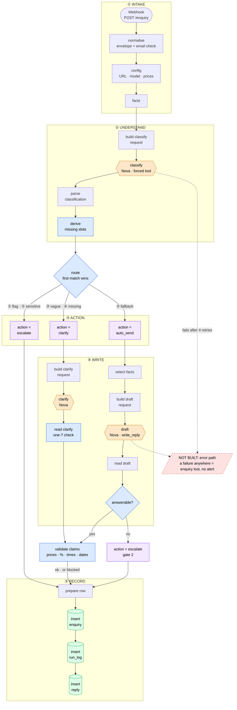

# Enquiry Desk — state

**Last updated:** 2026-10-11 · **session 2 done, committed and pushed** (`672b806`) — good stopping point
**Next session:** session 3 — the **failure path**: write-first intake → error workflow + Telegram → replay → chaos test (plan below)

## Status

The workflow runs end to end on **Amazon Nova 2 Lite (Bedrock)**, paid from the AWS Free Tier credit
($99, expires 2027-03-09; **rule: credits only**). Latest full run `20261011-001555` on 24 labelled cases:

| Category | Safety flags | Missing slots | **Action** | Invented prices in sendable replies | Errors | Cost / enquiry |
|---|---|---|---|---|---|---|
| 22/24 | 6/6 | 6/6 | **23/24** | **0/14** | 0 | ~$0.0012 |

Routing, the second gate, a one-question clarify reply and a claim validator are live. Every reply is
stored in `reply` (blocked ones with the reason). **Nothing is sent to customers.** The one action "miss"
is t06 → `blocked`: the draft calculated a £190 bundle and the validator stopped it.

Commits: Gemini version `9f383b3` · Nova move `2575bd4` · Switch `07d1120` · session 2 done `672b806`

## Before you stop

| # | Step | Why |
|---|---|---|
| 1–3 | ✅ Published, exported, scanned clean, committed + pushed (`672b806`) | — |
| 4 | **A7 credit check** — Cost Explorer, group by Service, charge type Usage + Credit, 2026-10-10 | Confirms "credits only" really holds (~$0.15 of Bedrock offset by a Credit line) |
| 5 | **Telegram bot** — token in n8n as `Telegram - alerts bot`, chat ID noted (session 3 step 0) | Needed for the alert |

Not blocking: t22's invented policy (see *Open issues*). Cosmetic: the `action = clarify` note and
sticky ② still describe the old design — tidy when convenient.

## How it flows (2026-10-11)



**Reading it:** orange = model calls (the only paid, non-deterministic steps) · blue = code that
*decides or checks* · purple = outcomes · green = Postgres · **red dashed = the gap session 3 closes.**
Route escalations get no AI draft; everything a model writes passes through code before it's stored.

## Session 3 plan — the failure path

**Goal:** no enquiry is ever silently lost. Today, if Bedrock fails 4 times or any node throws, the
execution dies *before* `insert enquiry`: the customer got a 200, there's no row and no alert. After
session 3, every enquiry is in Postgres within milliseconds of arriving, every failure is marked and
announced on Telegram, and a failed enquiry can be replayed with one command.

**Spec check:** the build guide lives on the Mac (`~/aian/get-rich/PROJECT-01-BUILD-GUIDE.md`), not the
Pi — open its session 3 section and cite its trap numbers where they apply.

### 0 · Before the session (you, ~10 min)

- [ ] **Telegram bot:** @BotFather → `/newbot` → token into n8n Credentials as **`Telegram - alerts bot`**
      (Telegram API type). Press *Start* in the bot. Chat ID from **@userinfobot** — not secret, tell the agent.
- [ ] **A7 credit check** in Cost Explorer (still open).

### A · Write first, enrich later (~45 min)

| Step | Change |
|---|---|
| A1 | **Schema:** `alter table enquiry add column n8n_execution_id text;` and use `status` = `received` → `processed` \| `failed`. Update `schema/schema.sql` too. |
| A2 | **New node `record received`** right after `normalise`: insert the raw envelope with `status = 'received'`, `n8n_execution_id = {{ $execution.id }}`. `on conflict (external_key) do update … where enquiry.status = 'failed'` — a failed row can be **reclaimed** by a replay; anything else is a duplicate and returns 0 rows, which **stops the run before any model call** (dedupe gets cheaper too). |
| A3 | **Re-attach the envelope** after it: a Postgres node replaces the item with its result, so `config` would see only `{id}`. A small Code node returns `$('normalise').all()`. *(This is the trap to understand, not just fix.)* |
| A4 | **`insert enquiry` → `update enquiry`:** `update … set category, confidence, language, safety_flags, missing_slots, action, status = 'processed' where id = $1 returning id`. |
| A5 | **`score.py`:** wait for `status in ('processed','failed')` — with write-first the row exists *before* processing, so the scorer would read a half-done row. Report failed rows separately. |

**Done when:** a normal POST still scores 23/24; a duplicate POST makes no model calls.

### B · Error workflow + Telegram alert (~45 min)

| Step | Change |
|---|---|
| B1 | **New workflow `01 Enquiry Desk - errors`:** Error Trigger → Code (execution id, failing node, error message, execution URL). |
| B2 | Postgres: `update enquiry set status = 'failed' where n8n_execution_id = $1 returning id, from_email, left(body, 120)`; then a `run_log` row (`stage` = failing node, `status = failed`, `error` = message). |
| B3 | **Telegram** (`Telegram - alerts bot`): case, failing node, error, link to the execution. Chat ID in a Set node in the errors workflow. |
| B4 | **Main workflow → Settings → Error workflow** = `01 Enquiry Desk - errors`. Publish **both**. |
| B5 | **Dead-letter view:** `create view dead_letter as select id, received_at, from_email, body from enquiry where status = 'failed';` |

Trap to expect: the Error Trigger fires for **production** executions, not manual *Execute workflow* runs
— test through the webhook.

**Done when:** a forced failure produces a `failed` row, a failed `run_log` row and a Telegram message.

### C · Replay (~20 min)

- C1 **`test/replay.py`** (stdlib, like `score.py`): reads `dead_letter`, re-POSTs each enquiry (same email +
  message) to the production webhook, waits for `processed`. A2's reclaim rule lets it through the dedupe.
- C2 `--dry-run` lists what it would replay.

**Done when:** a failed enquiry becomes `processed` after one `python3 test/replay.py`.

### D · Chaos test — the demo moment (~15 min)

1. Set `config.llm_url` to a bad host (e.g. `https://bedrock-runtime.invalid/…`), Publish.
2. POST t01 → within ~1 min: row `failed`, Telegram alert arrives.
3. Restore the URL, Publish → `python3 test/replay.py` → row `processed`, reply stored.
4. Full `score.py` run → still 23/24, 0 invented prices. Record it in *Results history*.

### E · If time is left (stretch, in this order)

1. **Real 400 for bad input** — Webhook → *Respond: using 'Respond to Webhook' node*; invalid email → 400
   with a JSON error; valid → 202 `{id}` after `record received` (the customer gets a reference).
2. **Tidy the stale notes** (`action = clarify`, sticky ②) and the red sticky.
3. **Loom outline** (record in session 4): t18 escalates at 0.90 → t06's £190 blocked → chaos test alert →
   replay → `score.py` numbers.

### Deferred to session 4 (and why)

- **Telegram approve / edit / take-over buttons** for `escalate` + `blocked` — the review queue; reuses
  B's bot. Needs the failure path first so approvals can't vanish either.
- **`llm-call` provider adapter** — only pays off with a second provider (Ollama); until then it's a refactor.
- **Policy-claim check (t22)** — `write_reply` returns `claims[{text, fact_key}]`, code checks each key.

### Who builds

Session 3 isn't covered by CLAUDE.md rule 1, so the agent can build it — but **A2–A3 are worth building
yourself** (the reclaim-on-conflict SQL and the "Postgres node replaces the item" trap are the two
lessons of the session). The agent reviews and runs the chaos test.

## Decisions (made by the agent on request, 2026-10-10/11)

1. **Models extract, code decides.** The classifier returns `details` (subject, level, timezone, year)
   as stated; the **`derive missing slots`** rule table decides what's missing (`trial_booking` needs
   subject + level, `scheduling` needs subject, the rest nothing; Year 10–11 ⇒ GCSE, 12–13 ⇒ A-Level).
   Model judgement was 2/6; extraction 24/24.
2. **Confidence is recorded, never routed on.** Nova gave 0.7–1.0 on everything; an `intent_clear` yes/no
   was true on 24/24 — dropped. "Vague" = `other` + no flags + nothing extracted.
3. **Category definitions** in the schema (one line each) — fixed t13, t17, t19.
4. **`route` Switch**, first match wins: ① any safety flag → escalate · ② `complaint_or_sensitive` →
   escalate · ③ vague → clarify · ④ missing slots → clarify · ⑤ fallback → auto_send. One output per rule
   (visible on the canvas); all paths rejoin at `prepare row` (no Merge — it would wait forever).
   **Route escalations get no AI draft** — a human writes complaints and safeguarding replies.
5. **Second gate:** the draft is a forced tool `write_reply` → `{reply, answerable, unanswered}`; IF
   `answerable?` false → escalate, draft kept as blocked with the reason. No tool call ⇒ not answerable.
   Wording that mattered: *"saying plainly we don't offer it is a complete answer"* (fixed t08, t23).
6. **Clarify:** code picks WHAT to ask from `missing_slots`; the model phrases it in the customer's
   language; code checks exactly one `?`/`？`, else a fixed template.
7. **Claim validator** (pure code): every price, %, time and date in a reply must be in the fact table
   (lesson times converted to UTC/UK allowed; unverified deadlines flagged by name). Fail ⇒ `blocked`.
8. **`score.py`** counts invented prices only in **unblocked** replies (what would reach a customer).

## Node map (32 incl. sticky notes)

| Stage | Nodes |
|---|---|
| Intake | `Webhook` → `normalise` → `config` → `facts` |
| Understand | `build classify request` → `classify` → `parse classification` → `derive missing slots` |
| Route | `route` → `action = escalate` / `action = clarify` / `action = auto_send` |
| Write: auto_send | `select facts` → `build draft request` → `draft` → `read draft` → `answerable?` → (`validate claims` \| `action = escalate (gate 2)`) |
| Write: clarify | `build clarify request` → `clarify` → `read clarify` → `validate claims` |
| Record | `prepare row` → `insert enquiry` → `insert run_log` → `insert reply` |

Credentials (n8n only): `Bedrock - API key` (Header Auth, `Bearer …`), `Postgres account`.
Settings: save successful production executions = all.

## Results history

| Run | Category | Flags | Slots | Action | Invented £ | Cost | Notes |
|---|---|---|---|---|---|---|---|
| `20261010-221447` | 21/24 | 5/5 | 2/6 | — | — | $0.00094 | **Nova baseline** |
| `20261010-223551` (5) | 5/5 | 4/4 | — | — | — | $0.00098 | Injection fix: t24 flags `prompt_injection` |
| `20261010-225917` | 20/24 | 6/6 | 5/6 | — | — | $0.00107 | `details` + code-derived slots |
| `20261010-230401` | 22/24 | 6/6 | 6/6 | sim. 19 | — | $0.00105 | Category definitions |
| `20261010-233801` | 22/24 | 6/6 | 6/6 | 19/24 | — | $0.00096 | `route` Switch live |
| `20261011-001132` | 22/24 | 6/6 | 6/6 | 21/24 | 0/12 | $0.00125 | Gate 2 + clarify + validator; t06 £190 blocked |
| `20261011-001555` | 22/24 | 6/6 | 6/6 | **23/24** | **0/14** | $0.00122 | "Not offered = answered" wording |

Run-to-run variance at temperature 0 is ±1–2/24 on category — compare runs, not single cases.

## Open issues

- **Invented policies get through (t22):** "we offer flexibility, she can start mid-term in November" —
  not in the facts; the validator only checks numbers. → *Next feature*, item 2.
- **`blocked` vs `escalate` in `score.py`:** both reach a human; kept strict (t06 counts as a miss).
- **t15 / t23 categories** still wrong (past-paper bank → course_content; US admissions →
  course_content) — harmless now: both replies are correct.
- **A7** pending. Open billing question: does the credit cover Claude on Bedrock?
- `score.py`: no error-type counts (503 / 429 / timeout); stale `--psql` docstring example.
- `test/test.json` is a scratch file — keep out of commits.

## How to run things

```bash
set -a; source .env; set +a          # loads WEBHOOK_PROD_URL
python3 test/score.py --webhook "$WEBHOOK_PROD_URL" \
  --psql "docker exec -i n8n-stack-postgres-1 psql -U n8n -d n8n"        # all 24, ~5 min, ~3¢
# --only t06,t22   to run a few cases
```
Export ritual: **reload the n8n tab** if the agent edited the workflow → **unpin all** → export to
`workflows/01-intake.mine.json` → agent scans → commit (no attribution trailer).

## Things learned — don't relearn them

**n8n**
- **A stale browser tab overwrites API edits** — and the stale save gets published. Happened twice.
  **Reload after every agent edit; never Save in an old tab.**
- **"Active" is now "Publish"** (n8n 2.x). Save edits the draft; production runs the published version.
  n8n-mcp edits land in both; a UI save (e.g. Tidy up) leaves draft ≠ live until you Publish.
- **The webhook answers 200 before the workflow runs** — a throw still returns 200.
- **Postgres `queryReplacement` as a comma list splits values with commas** → use `={{ [ … ] }}`.
- **A node with several incoming branches runs once per arriving branch** — no Merge needed when only
  one branch fires (Merge waits for all inputs).
- **`{{ }}` in SQL is string pasting** → every value via `$1..$n`. After a Postgres node use
  `$('node').first()`. Same-day re-runs of pinned data write nothing (`external_key` dedupe).
- **n8n-mcp blocks private IPs by default** → `WEBHOOK_SECURITY_MODE=permissive` (dev-only Pi).
- **Tailscale Serve injects identity headers** — `normalise` drops them; execution history keeps them.

**Models**
- **Structured JSON on Bedrock = forced tool call**; result parsed in `toolUse.input`. Shape is enforced,
  correctness isn't.
- **Self-reported confidence and vague yes/no fields are useless** (0.7–1.0 everywhere; `intent_clear`
  24/24 true). **A yes/no tied to a concrete check works** (`answerable` ≈ "did you have to say *I'll
  check*?") — but the wording decides it.
- **Let models extract, let code decide** — extraction 24/24 vs judgement 2/6.
- **A numeric validator can't catch invented policies** — needs claims tied to fact keys, or a judge.
- **Gemini free tier = 20 requests/day per model**; thinking made calls slow enough to time out.

**AWS**
- **Credit covers "Sold by: AWS" only** — Claude/Grok/GPT on Bedrock are sold via Marketplace.
- **Cross-region inference needs the profile ID** (`global.amazon.nova-2-lite-v1:0`); global profiles
  need `arn:aws:bedrock:::foundation-model/…` in IAM. New accounts: Bedrock 403 for ~2 h while verified.
- **Two CLI profiles on the Pi:** `default` = `017820696925` (not this project). Bedrock + `$5` budget
  (credits excluded) = `718339078322`, region `ap-southeast-1`.

**Shell**
- `set -a; source .env; set +a` to load `.env`. `docker exec -i … psql` with nothing piped just waits.

## Later

- **Local LLM backend:** Ollama on the M5 MacBook (~8B, `format` = schema, `think: false`) as an
  `llm-call` branch; score local vs Nova on the 24 cases. RTX 4060 box if it must be always on.
- **LLM-as-judge** in `score.py` for `note_expected` cases (t03, t19, t22, t23).
- **Follow-up workflow** (the `followup` table): nudge unanswered clarify replies after 48 h.

## Session 4 — make it sellable (before pitching)

Verdict: **strong as proof of capability, weak as a product** — what sells is reliability you can show
numbers for, in the buyer's own tools, proven on one real business.

1. **Presentable numbers** + a Loom showing t06's £190 being **blocked** and t18 escalating at 0.90.
2. **Real channel:** Gmail/Outlook in → reply as a **draft in their inbox** → Telegram/Slack approve.
   Staged rollout: approve-all → auto-send the safe categories.
3. **Outcome-first pitch:** "Asian-timezone enquiries wait 7 hours; this answers the safe majority in
   minutes and hands the rest to a human by morning."
4. **One real pilot** → one-page case study (confirm Bedrock data terms before any real data).
5. **Sell as a service:** setup + monthly retainer (monitoring, fact updates, `score.py` as a gate).
6. **Honest scale:** "24 hand-labelled cases incl. the hardest failure modes" — grow with pilot data.
